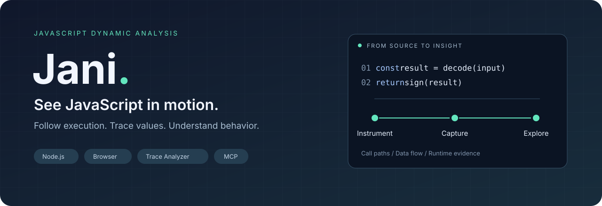

<p align="center">
  
</p>

<p align="center">
  <a href="README.md">English</a> · <a href="README.zh-CN.md">简体中文</a>
</p>

<p align="center">
  
  
  <a href="LICENSE.txt"></a>
</p>

# 看清 JavaScript 运行时到底做了什么。

**Jani 是一个用于调试、逆向分析和开发自定义运行时分析的 JavaScript 动态分析框架。** 它通过源码插桩记录真实执行过程，帮助你追踪函数调用、观察变量变化，并分析数据如何流向最终输出，支持 Node.js 和浏览器。

用 **CLI** 采集和处理执行轨迹，用**本地 Trace Analyzer** 可视化探索，或通过 **MCP 工具**让 AI 助手基于执行证据协助分析。

[快速开始](#快速开始) · [可视化分析](#可视化探索执行轨迹) · [自定义分析](#编写自己的分析插件) · [文档](#文档)

## Jani 能帮你解决什么问题？

| 你想知道 | Jani 提供的分析手段 |
| --- | --- |
| 这个结果经过哪些函数计算出来？ | 执行事件、源码位置映射、调用图重建 |
| 这个变量的值从哪里来？ | 变量生命周期、数据流、污点追踪、反向切片 |
| 陌生或混淆的脚本实际在做什么？ | 可选预处理、运行轨迹、循环分析、对象变异追踪 |
| 哪些代码执行得最频繁？ | 代码行执行次数、热路径分析 |
| 这里是否存在加密算法或签名逻辑？ | Trace Analyzer 中的值模式、加密和签名分析 |
| 能否检测自己的业务规则或运行时模式？ | 变量读写、属性访问、函数调用、运算符等可组合分析钩子 |

算法和加密识别提供分析线索，需要结合源码和执行轨迹验证。轨迹反映的是本次输入实际触发的执行路径。

## 有哪些特点？

- **从采集到分析的完整流程。** 源码插桩、执行记录、命令行报告、本地 Web 界面和 MCP 工具相互衔接。
- **行为能够定位回源码。** 通过指令 ID 和源码位置映射，将运行时事件与具体代码关联。
- **区分作用域与执行上下文。** 词法作用域 ID、Shadow Frame 和异步上下文钩子帮助追踪同名变量及不同执行上下文。
- **按需插桩。** 静态分析插件所需钩子，结合 def-use 决策选择插桩路径，支持轻量变量读取；实际开销取决于程序和启用的分析。
- **同时覆盖 Node.js 和浏览器。** 支持 Node.js 文件输出，以及浏览器 WebSocket、IndexedDB 等采集后端。
- **分析能力可扩展。** ESM 模块、Babel 插桩引擎、运行时插件和离线分析插件提供不同层次的扩展入口。

## 快速开始

需要 **Node.js 22+** 和 **npm 10+**。以下命令均在克隆后的仓库根目录执行。

```bash
git clone https://github.com/fuckreverse/Jani.git
cd Jani
npm install
```

### 采集第一份执行轨迹

创建一个小脚本，然后插桩并执行：

```bash
node --input-type=module -e "import { writeFileSync } from 'node:fs'; writeFileSync('demo.js', 'function double(x) { return x * 2; }\nconsole.log(double(21));\n');"
node bin/jalangi.mjs instrument-and-run --execution-trace --trace-file demo.bin demo.js
```

脚本会输出 `42`，同时生成 `demo.bin` 和 `demo.smap.json`，分别保存执行轨迹及其源码映射。

将轨迹解码为带源码位置的结构化事件：

```bash
node tools/trace-parse.mjs demo.bin --smap demo.smap.json > demo.events.ndjson
```

渲染、过滤、调用树和变量时序分析见[离线分析工具文档](docs/Offline-Analysis-Tools.md)。解析器支持二进制和旧文本轨迹，下游工具对不同格式的选项以该文档为准。

### 为浏览器生成插桩代码

```bash
node bin/jalangi.mjs instrument --target browser --output demo.browser.js demo.js
```

在浏览器测试页面中加载生成文件。采集后端、运行时拆分和模块选项见 [CLI 参考](docs/CLI-Reference.md)。需要保留源文件时请显式指定 `--output`，浏览器插桩默认会覆盖输入文件。

## 可视化探索执行轨迹

**Jani Trace Analyzer（JTA）** 是本地 Web 分析平台，提供工作空间、插桩工作台、Trace 收集和分析会话。

可以查看执行事件、函数、数据流、循环、对象变异、值模式，以及加密和混淆线索。配套 MCP Server 可将分析工具提供给兼容的 AI 客户端。

```bash
npm install --prefix analyzer
npm install --prefix analyzer/ui
npm run analyzer:prod
```

打开 [localhost:33000](http://localhost:33000)，上传 `demo.bin` 和 `demo.smap.json` 创建分析会话，也可以从 JavaScript 源码创建工作空间。

具体操作、API、开发模式和 MCP 配置见 [Trace Analyzer 指南](analyzer/README.md)。

## 编写自己的分析插件

只注册需要的钩子。下面的例子记录变量读取：

```js
import vm from 'node:vm';
import { init, instrumentCode } from './src/instrument/esnstrument.js';
import { JalangiSandbox } from './src/runtime/JalangiSandbox.js';

const J$ = new JalangiSandbox();
J$.analysis.use({
  read(iid, name, value) {
    console.log(`${name} = ${value}`);
    return { result: value };
  },
});

init({ INSTR_READ: null });
const { code } = instrumentCode({
  code: 'var answer = 42; var result = answer + 1;',
  origCodeFileName: 'example.js',
  instCodeFileName: 'example.inst.js',
});
vm.runInNewContext(code, { J$ });
```

进一步了解[插件开发](docs/Analysis-Development.md)、[配置参考](docs/Configuration.md)，或浏览 [`src/plugins/`](src/plugins/) 中的运行时检查、钩子日志、覆盖率及执行追踪示例。

## 工作原理

```text
JavaScript 源码
  → 可选预处理（简化代码 / 语法降级）
  → Babel AST + 作用域和 def-use 分析
  → 插桩代码 + 运行时钩子
  → 在 Node.js 或浏览器中执行
  → 执行轨迹 + 源码映射
  → CLI 工具 / Trace Analyzer / MCP
```

Jani 基于 [Samsung Jalangi2](https://github.com/Samsung/jalangi2) 的插桩设计思想，采用 ESM、Babel 引擎、作用域感知插桩及执行轨迹分析工具链。解析器支持 TypeScript/Flow 语法不代表类型语法可以直接执行；请先准备适合目标运行环境的 JavaScript。

## 文档

详细技术文档目前主要为中文。

| 文档 | 内容 |
| --- | --- |
| [文档索引](docs/README.md) | 完整技术文档导航 |
| [CLI 参考](docs/CLI-Reference.md) | 插桩、执行、采集及浏览器选项 |
| [插桩引擎](docs/Instrumentation-Engine.md) | 编程 API 和变换实现 |
| [运行时系统](docs/Runtime-System.md) | 钩子、插件调度与影子内存 |
| [插件开发](docs/Analysis-Development.md) | 编写自定义运行时分析 |
| [预处理](docs/Preprocessing.md) | 代码简化与语法降级 |
| [日志系统](docs/Logger-System.md) | Trace 后端与采集 |
| [离线分析工具](docs/Offline-Analysis-Tools.md) | 解析、渲染、过滤与报告 |
| [Trace Analyzer](analyzer/README.md) | 本地 Web UI、分析插件、REST API 和 MCP |

## 开发与贡献

```bash
npm test                     # 核心单元和集成测试
npm run test:backend         # Trace Analyzer 后端测试
```

分组测试说明见[测试指南](docs/Testing-System.md)。欢迎通过 [Issue](https://github.com/fuckreverse/Jani/issues) 和 Pull Request 提交问题、可复现的轨迹示例、分析插件与文档改进。

## 许可与致谢

使用 [Apache License 2.0](LICENSE.txt) 许可。Jani 基于 Samsung Research America 的 Jalangi2 工作构建，原有代码保留原作者版权声明。
