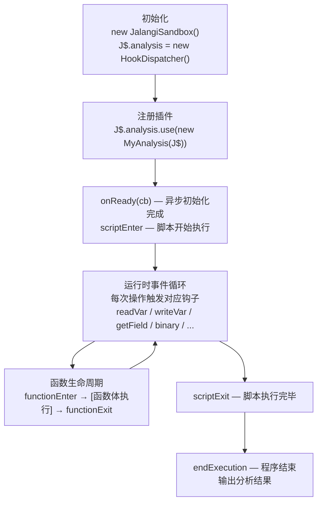
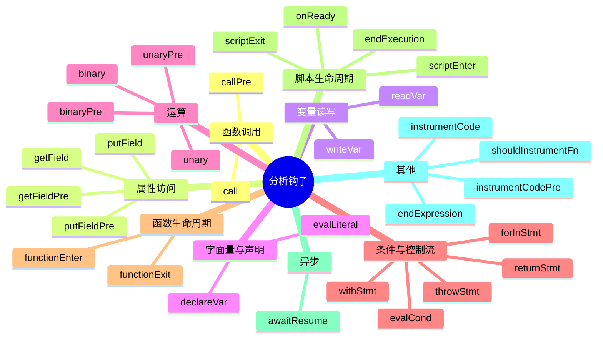

# 分析插件开发指南

## 概述

Jani 允许开发者通过编写**分析插件（Analysis Plugin）**来监测和修改 JavaScript 程序的运行时行为。
每个分析插件是一个普通的 JavaScript 类，实现一组钩子（hook）方法。
当插桩代码执行到相应操作时，运行时会调用对应的钩子。

**插件生命周期**：



## 快速开始

### 1. 创建分析插件类

```js
// my-analysis.js

// JALANGI DO NOT INSTRUMENT

/**
 * 示例分析：统计变量读取次数
 */
export class ReadCountAnalysis {
    constructor(sandbox) {
        this._sandbox = sandbox;
        this._readCounts = {};
    }

    readVar(iid, name, val, isGlobal, isScriptLocal) {
        this._readCounts[name] = (this._readCounts[name] ?? 0) + 1;
        return { result: val };  // 不修改值
    }

    endExecution() {
        console.log('Variable read counts:', this._readCounts);
    }
}
```

### 2. 注册插件并运行

```js
// setup.js

import { JalangiSandbox }     from './src/runtime/JalangiSandbox.js';
import { ReadCountAnalysis }   from './my-analysis.js';

// 初始化沙盒
const J$ = globalThis.J$ = new JalangiSandbox();

// 注册分析插件
J$.analysis.use(new ReadCountAnalysis(J$));
```

## 所有可用钩子

以下所有钩子方法均可选实现，未实现的方法不影响程序语义（被动观测模式）。



### 函数调用

#### `callPre(iid, f, base, args, isConstructor, isMethod, functionIid, functionSid)`

函数/方法/构造器调用之**前**触发。

| 参数 | 说明 |
|------|------|
| `iid` | 指令 ID |
| `f` | 被调函数对象 |
| `base` | 接收者（this）|
| `args` | 参数列表（Array）|
| `isConstructor` | 是否 `new` 调用 |
| `isMethod` | 是否方法调用 |
| `functionIid` | 函数定义处的 iid |
| `functionSid` | 函数定义处的 sid |

**返回值**：`{ f, base, args, skip }` 或 `undefined`。
- 修改 `f` / `base` / `args` 可替换调用目标或参数
- `skip: true` 跳过函数调用（仍会触发 `call`，result 为 undefined）

#### `call(iid, f, base, args, result, isConstructor, isMethod, functionIid, functionSid)`

函数/方法/构造器调用之**后**触发。

**返回值**：`{ result }` 或 `undefined`。修改 `result` 可替换调用返回值。

---

### 属性访问

#### `getFieldPre(iid, base, offset, isComputed, isOpAssign, isMethodCall)`

属性读取之**前**触发（`obj.prop` 或 `obj[key]`）。

**返回值**：`{ base, offset, skip }` 或 `undefined`。

#### `getField(iid, base, offset, val, isComputed, isOpAssign, isMethodCall)`

属性读取之**后**触发，`val` 是实际读到的值。

**返回值**：`{ result }` 或 `undefined`。

#### `putFieldPre(iid, base, offset, val, isComputed, isOpAssign)`

属性写入之**前**触发。

**返回值**：`{ base, offset, val, skip }` 或 `undefined`。

> **注意**：`isOpAssign` 在普通属性赋值（`obj.x = val`，经由 `J$.P`）场景下**始终为 `false`**。
> 属性复合赋值（`obj.x += 1` 等）走独立的 `J$.Ca` 钩子（由 `INSTR_PROPERTY_BINARY_ASSIGNMENT` 控制），
> 不会触发 `putFieldPre` / `putField`。

#### `putField(iid, base, offset, val, isComputed, isOpAssign)`

属性写入之**后**触发。

**返回值**：`{ result }` 或 `undefined`。

> **注意**：同 `putFieldPre`，通过 `J$.P` 路径触发时 `isOpAssign` 始终为 `false`。

---

### 变量读写

#### `readVar(iid, name, val, isGlobal, isScriptLocal)`

变量读取之**后**触发（仅 Post，无对应 Pre）。

> **设计说明**：变量读取前无法预知即将读到的值，Pre 无法提供有意义的参数，
> 因此只提供 Post 版本（值已知，可观测/替换）。

| 参数 | 说明 |
|------|------|
| `name` | 变量名 |
| `val` | 读到的值 |
| `isGlobal` | 是否未声明的全局变量 |
| `isScriptLocal` | 是否用 `var` 声明的脚本级变量 |

**返回值**：`{ result }` 或 `undefined`。

#### `writeVar(iid, name, val, lhs, isGlobal, isScriptLocal)`

变量写入之**前**触发（仅 Pre，无对应 Post）。`lhs` 是写入前的旧值。

> **设计说明**：变量写操作关注的是"写入前能否修改/拦截值"，写完后可通过 `readVar` 观测结果，
> 不需要单独的 Post 版本，因此只提供 Pre 版本。

**返回值**：`{ result }` 或 `undefined`。

---

### 字面量与声明

#### `evalLiteral(iid, val, hasGetterSetter)`

字面量（数字/字符串/布尔/null/对象/数组/函数/正则/BigInt）创建后触发（仅 Post，无对应 Pre）。

> **设计说明**：字面量是编译期常量，创建前无可修改的内容，Pre 没有意义；
> 只在字面量值确定后通知分析器。

**返回值**：`{ result }` 或 `undefined`。

#### `declareVar(iid, name, val, isArgument, argumentIndex, isCatchParam)`

作用域开始时，对每个局部变量/形参/函数声明触发。

**返回值**：`{ result }` 或 `undefined`。

---

### 运算

#### `binaryPre(iid, op, left, right, isOpAssign, isSwitchCaseComparison, isComputed)`

二元运算之前触发。支持 `+`, `-`, `*`, `/`, `%`, `&`, `|`, `^`, `<<`, `>>`, `>>>`,
`<`, `>`, `<=`, `>=`, `==`, `!=`, `===`, `!==`, `instanceof`, `delete`, `in` 等。

**返回值**：`{ op, left, right, skip }` 或 `undefined`。

#### `binary(iid, op, left, right, result, isOpAssign, isSwitchCaseComparison, isComputed)`

二元运算之后触发。

**返回值**：`{ result }` 或 `undefined`。

#### `unaryPre(iid, op, left)` / `unary(iid, op, left, result)`

一元运算前/后触发（`!`, `-`, `+`, `~`, `typeof`, `void` 等）。

---

### 条件与控制流

#### `evalCond(iid, result)`

条件判断时触发（`if`, `while`, `?:`, `&&`, `||`, `switch` 等）（仅 Post，无对应 Pre）。

> **设计说明**：条件表达式本身的求值结果才是这个钩子的输入，"求值前"等同于还没有可观测的条件值，
> Pre 无法提供有意义的参数；因此只在条件值确定后触发，允许分析器修改分支走向。

**返回值**：`{ result }` 或 `undefined`。修改 result 可控制分支走向。

#### `returnStmt(iid, val)` / `throwStmt(iid, val)` / `withStmt(iid, val)`

`return` / `throw` / `with` 语句触发。

---

### 命名体系说明：Pre/Post 与 Enter/Exit

回调接口中存在**两套**表示"操作边界"的命名体系，它们并非命名疏忽，而是描述两类本质不同的语义：

**Pre/Post 体系**（`getFieldPre`/`getField`、`callPre`/`call`、`binaryPre`/`binary` 等）

- 描述**单个原子表达式**的两个时间点
- Pre 和 Post 的参数高度重叠，Post 只是多了 `result`
- 两次调用之间**几乎没有其他代码执行**（紧密包裹同一个表达式）
- Pre 提供拦截能力（`skip: true`），Post 提供结果替换（`result: newVal`）
- 类比：对一次数据库查询语句的 before/after hook

**Enter/Exit 体系**（`functionEnter`/`functionExit`、`scriptEnter`/`scriptExit`）

- 描述**一个执行作用域**（函数体 / 脚本体）的两个边界
- Enter 和 Exit 的参数**完全不同**：Enter 拿到 `f/dis/args`，Exit 拿到 `returnVal/wrappedExceptionVal`
- 两次调用之间可以有**任意行代码执行**，期间还可触发无数其他钩子（递归嵌套也是合法的）
- Enter 的返回值被忽略（无法阻止函数体执行），Exit 支持 `isBacktrack`（MultiSE 符号执行用）
- 类比：数据库事务的 BEGIN / COMMIT

**两套体系的关键区别一览**：

| 维度 | Pre/Post | Enter/Exit |
|------|---------|-----------|
| 对应的 JS 单元 | 单个表达式/运算 | 完整执行作用域（函数体/脚本） |
| 两端参数关系 | 高度对称，Post 多 `result` | 完全不同，各自独立 |
| 之间是否有其他钩子 | 否（紧密包裹） | 是（任意多个） |
| Pre/Enter 能否阻止执行 | 能（`skip: true`）| 否 |
| Post/Exit 能否修改结果 | 能（`result: newVal`）| Exit 只能修改 `returnVal` |

> **常见困惑**：`functionEnter` ≠ "函数的 `callPre`"。`callPre` 在**调用方**上下文中触发（此时
> 被调函数还未执行），`functionEnter` 在**被调函数体内部**触发（`this` 和参数已绑定完毕）。
> 两者都会触发，顺序为 `callPre` → `functionEnter` → 函数体 → `functionExit` → `call`。

---

### 函数/脚本生命周期

#### `functionEnter(iid, f, dis, args)`

函数体开始执行前触发。返回值被忽略。

#### `functionExit(iid, returnVal, wrappedExceptionVal)`

函数体执行完毕后触发（正常返回或抛出异常均触发）。

**返回值**：`{ returnVal, wrappedExceptionVal, isBacktrack }` 或 `undefined`。
`isBacktrack: true` 可让控制流跳回函数体开头（用于符号执行回溯）。

#### `scriptEnter(iid, instrumentedFileName, originalFileName)` / `scriptExit(iid, wrappedExceptionVal)`

脚本级别的进入/退出钩子。

---

### 其他

#### `forInStmt(iid, val)`

`for-in` 循环迭代对象时触发。

---

### 异步

#### `awaitResume(iid, contextId, val)`

`await` 表达式恢复（Promise 就绪）时触发。

| 参数 | 说明 |
|------|---------|
| `iid` | 指令 ID（`await` 表达式所在位置） |
| `contextId` | 本次 async 函数调用的唯一上下文 ID（由插桩在 async 函数入口注入的 `J$__ctx` 局部变量带出） |
| `val` | `await` 的 resolved value（注意：返回将被忽略，无法修改它） |

返回将被忽略（`val` 由 `J$.Aw` 直接透传，不支持修改）。

**常见用途**：在 `awaitResume` 中需要用 `contextId` 来关联同一次 async 函数调用中多次 await 的事件。同一次调用的所有 `awaitResume` 共享相同的 `contextId`；不同次调用（即使是同一函数）的 `contextId` 必不相同。

```js
// 示例：按 contextId 收集每次 async 调用的 await 轨迹
class AsyncTraceAnalysis {
    constructor() {
        this._traces = new Map(); // contextId → [{iid, val}, ...]
    }

    awaitResume(iid, contextId, val) {
        let events = this._traces.get(contextId);
        if (!events) { events = []; this._traces.set(contextId, events); }
        events.push({ iid, val });
        // 不返回（无法修改 val）
    }

    endExecution() {
        for (const [ctxId, events] of this._traces) {
            console.log(`async 调用 #${ctxId}:`, events);
        }
    }
}
```

> **插桩开关**：`awaitResume` 需要 `Config.INSTR_AWAIT` 不为 `() => false`。
> 使用 `pluginAnalyzer.js` 自动推导配置时，常量内 `awaitResume` 函数名将自动开启 `INSTR_AWAIT`。

#### `endExpression(iid)`

表达式语句末尾触发（用于标记表达式结束）。

#### `endExecution()`

程序执行完毕后触发（Node.js 环境下），用于输出分析结果。

#### `onReady(cb)`

Node.js 模式下，异步初始化完成后调用 `cb` 开始执行目标程序。
在此钩子中可进行异步初始化（如加载数据库）。

---

## 修改程序行为

大多数钩子可以通过返回值修改程序的执行行为：

```js
// 示例：将所有数字加法结果偏移 1
binary(iid, op, left, right, result) {
    if (op === '+' && typeof result === 'number') {
        return { result: result + 1 };
    }
    // 不返回（或返回 undefined）= 不修改
}

// 示例：阻止某个方法调用
callPre(iid, f, base, args) {
    if (f.name === 'dangerousMethod') {
        console.warn('Blocked dangerous call at', this._sandbox.iidToLocation(this._sandbox.lastSid, iid));
        return { f, base, args, skip: true };
    }
}

// 示例：替换属性读取结果
getField(iid, base, offset, val) {
    if (base === config && offset === 'secret') {
        return { result: '***' };  // 屏蔽敏感字段
    }
}
```

## 访问源码位置

每个钩子都传入 `iid`（Instruction ID），可通过沙盒查询对应的源码位置：

```js
class MyAnalysis {
    constructor(sandbox) {
        this._sandbox = sandbox;
    }

    readVar(iid, name, val, isGlobal) {
        const loc = this._sandbox.iidToLocation(this._sandbox.lastSid, iid);
        // → "(example.js:3:5:3:10)"
        console.log(`Read ${name} at ${loc}`);
        return { result: val };
    }
}
```

## 使用 Shadow Memory

如果需要追踪对象的元数据（如对象 ID、分配点等），可以使用 `SMemory`：

```js
import { SMemory, SMemoryPlugin } from './src/runtime/SMemory.js';

const smemory = new SMemory(J$);
J$.analysis.use(new SMemoryPlugin(smemory));
J$.analysis.use(new MyAnalysis(smemory, J$));

// 在分析插件中
class MyAnalysis {
    constructor(smemory, sandbox) {
        this._mem = smemory;
        this._sandbox = sandbox;
    }

    getField(iid, base, offset, val) {
        const shadow = this._mem.getShadowObjectOfObject(base);
        const id = this._mem.getIDFromShadowObjectOrFrame(shadow);
        console.log(`Read ${offset} from object #${id}`);
        return { result: val };
    }
}
```

## 链式注册多个分析

```js
import { HookDispatcher }            from './src/runtime/HookDispatcher.js';
import { SMemory, SMemoryPlugin }  from './src/runtime/SMemory.js';
import { TraceAllAnalysis }        from './src/plugins/pldi16/TraceAll.js';
import { MyCustomAnalysis }        from './my-analysis.js';

const smemory = new SMemory(J$);
J$.smemory = smemory;

J$.analysis = new HookDispatcher()
    .use(new SMemoryPlugin(smemory))    // 先注册 SMemory，确保后续插件可用
    .use(new TraceAllAnalysis(J$))
    .use(new MyCustomAnalysis(J$));
```

## 完整示例：NaN 检测分析

以下是一个完整的 NaN 检测分析，检测 NaN 传播问题：

```js
// check-nan.js
// JALANGI DO NOT INSTRUMENT

export class CheckNaNAnalysis {
    constructor(sandbox) {
        this._sandbox = sandbox;
        this._nanLocations = [];
    }

    binary(iid, op, left, right, result) {
        if (typeof result === 'number' && isNaN(result)
                && !isNaN(left) && !isNaN(right)) {
            const loc = this._sandbox.iidToLocation(this._sandbox.lastSid, iid);
            this._nanLocations.push({
                op, left, right, loc,
                message: `NaN produced by ${left} ${op} ${right} at ${loc}`,
            });
        }
        return { result };
    }

    readVar(iid, name, val, isGlobal) {
        if (typeof val === 'number' && isNaN(val) && isGlobal) {
            const loc = this._sandbox.iidToLocation(this._sandbox.lastSid, iid);
            this._nanLocations.push({
                name, loc,
                message: `NaN read from global ${name} at ${loc}`,
            });
        }
        return { result: val };
    }

    endExecution() {
        if (this._nanLocations.length > 0) {
            console.warn(`[CheckNaN] Found ${this._nanLocations.length} NaN issues:`);
            for (const item of this._nanLocations) {
                console.warn('  -', item.message);
            }
        } else {
            console.log('[CheckNaN] No NaN issues found.');
        }
    }
}
```

## 内置示例分析

| 插件 | 路径 | 说明 |
|------|------|------|
| `LogAllAnalysis` | `src/plugins/tutorial/LogAll.js` | 记录所有运行时事件 |
| `TraceAllAnalysis` | `src/plugins/pldi16/TraceAll.js` | 完整执行跟踪（含 SMemory）|
| `BranchCoverageAnalysis` | `src/plugins/tutorial/BranchCoverage.js` | 分支覆盖率统计 |
| `BacktrackLoopAnalysis` | `src/plugins/tutorial/BacktrackLoop.js` | 回溯循环示例 |
| `CheckNaN` | `src/plugins/dlint/CheckNaN.js` | NaN 检测 |
| `UndefinedOffset` | `src/plugins/dlint/UndefinedOffset.js` | undefined 属性访问检测 |

详见 [Analysis-Plugins.md](./Analysis-Plugins.md)。

## 注意事项

1. **文件头部需加 `// JALANGI DO NOT INSTRUMENT`**，防止分析插件自身被插桩
2. 钩子方法**不需要全部实现**，只实现需要的即可
3. 若不修改值，可以直接不返回（返回 `undefined`），或返回原值
4. `functionEnter` 和 `scriptEnter` 的**返回值被忽略**
5. 若需要异步初始化，在 `onReady(cb)` 中完成后调用 `cb()`
6. 使用 Shadow Memory 时，**必须先注册 `SMemoryPlugin`**，再注册依赖它的分析
