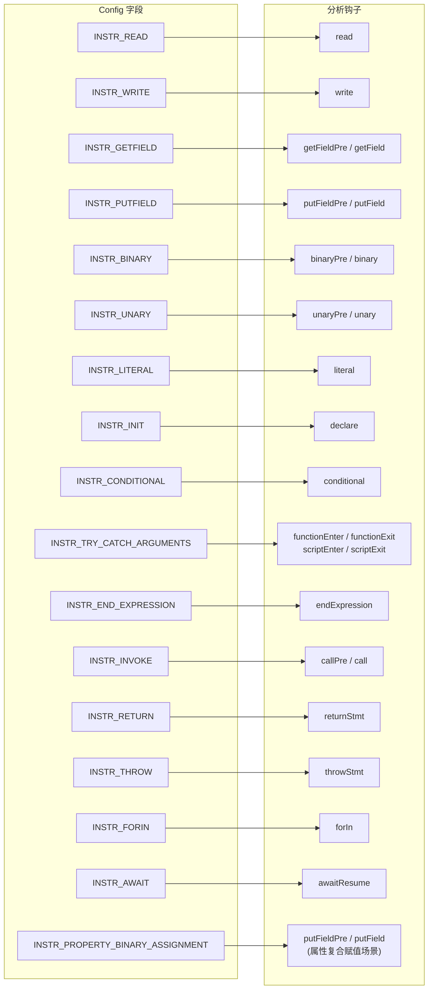

# DOC-03 · Config 配置参考

## 概述

`Config` 对象传入 `init(config)` 函数，控制插桩器对哪些 JavaScript 操作进行插桩，
以及是否启用采样模式。

## Config 字段完整参考

### 插桩开关字段

每个字段控制一类操作是否被插桩。字段值的含义：

| 值 | 含义 |
|----|------|
| `null` / `undefined` | **全部插桩**该类型的操作（默认行为）|
| `false` / `() => false` | **完全禁用**该类型的插桩 |
| `(ast) => boolean` | **细粒度控制**：函数返回 `true` 时插桩，`false` 时跳过 |

| 字段 | 控制范围 | 分析钩子 |
|------|---------|---------|
| `INSTR_READ` | 变量读取（`J$.R` / `J$.Rl`）| `read` |
| `INSTR_WRITE` | 变量写入（`J$.W`）| `write` |
| `INSTR_GETFIELD` | 属性读取（`J$.G`）| `getFieldPre` / `getField` |
| `INSTR_PUTFIELD` | 属性写入（`J$.P`）| `putFieldPre` / `putField` |
| `INSTR_BINARY` | 二元运算（`J$.B`）| `binaryPre` / `binary` |
| `INSTR_UNARY` | 一元运算（`J$.U`）| `unaryPre` / `unary` |
| `INSTR_LITERAL` | 字面量（`J$.T`）| `literal` |
| `INSTR_INIT` | 变量声明初始化（`J$.Dc`）| `declare` |
| `INSTR_CONDITIONAL` | 条件表达式 / switch（`J$.C`）| `conditional` |
| `INSTR_TRY_CATCH_ARGUMENTS` | 函数/脚本 try-catch 包裹 | `functionEnter` / `functionExit` / `scriptEnter` / `scriptExit` |
| `INSTR_END_EXPRESSION` | 表达式语句末尾标记（`J$.Xe`）| `endExpression` |
| `INSTR_INVOKE` | 函数/方法调用（`J$.F` / `J$.M`）| `callPre` / `call` |
| `INSTR_RETURN` | return 语句（`J$.Rt`）| `returnStmt` |
| `INSTR_THROW` | throw 语句（`J$.Th`）| `throwStmt` |
| `INSTR_FORIN` | for-in 循环（`J$.Fi`）| `forIn` |
| `INSTR_AWAIT` | `await` 恢复点（`J$.Aw`）| `awaitResume` |
| `INSTR_PROPERTY_BINARY_ASSIGNMENT` | 属性复合赋值（`obj.x += 1`，`J$.Ca`）| `putFieldPre` / `putField` |

### 采样模式字段

| 字段 | 类型 | 默认 | 说明 |
|------|------|------|------|
| `ENABLE_SAMPLING` | `boolean` | `false` | 启用采样模式，每个函数可在插桩/非插桩版本间切换 |

## Config 字段与钩子对应关系



## 常用 Config 组合

### 全量插桩（开发/调试）

```js
const Config = {
    INSTR_READ:               null,
    INSTR_WRITE:              null,
    INSTR_GETFIELD:           null,
    INSTR_PUTFIELD:           null,
    INSTR_BINARY:             null,
    INSTR_UNARY:              null,
    INSTR_LITERAL:            null,
    INSTR_INIT:               null,
    INSTR_CONDITIONAL:        null,
    INSTR_TRY_CATCH_ARGUMENTS: null,
    INSTR_END_EXPRESSION:     null,
    INSTR_INVOKE:             null,
    INSTR_RETURN:             null,
    INSTR_THROW:              null,
    INSTR_FORIN:              null,
    INSTR_AWAIT:              null,
    INSTR_PROPERTY_BINARY_ASSIGNMENT: null,
    ENABLE_SAMPLING:          false,
};

// 简便写法：使用 pluginAnalyzer.fullConfig()
import { fullConfig } from './src/instrument/pluginAnalyzer.js';
const Config = fullConfig();
```

### 最小插桩（只关注函数进出）

```js
const Config = {
    INSTR_READ:               () => false,
    INSTR_WRITE:              () => false,
    INSTR_GETFIELD:           () => false,
    INSTR_PUTFIELD:           () => false,
    INSTR_BINARY:             () => false,
    INSTR_UNARY:              () => false,
    INSTR_LITERAL:            () => false,
    INSTR_INIT:               () => false,
    INSTR_CONDITIONAL:        () => false,
    INSTR_TRY_CATCH_ARGUMENTS: null,   // 保留函数进出
    INSTR_END_EXPRESSION:     () => false,
    INSTR_INVOKE:             null,    // 保留函数调用
    INSTR_RETURN:             () => false,
    INSTR_THROW:              () => false,
    INSTR_FORIN:              () => false,
    INSTR_AWAIT:              () => false,
    INSTR_PROPERTY_BINARY_ASSIGNMENT: () => false,
    ENABLE_SAMPLING:          false,
};
```

### 只插桩属性访问

```js
const Config = {
    INSTR_READ:               () => false,
    INSTR_WRITE:              () => false,
    INSTR_GETFIELD:           null,   // 开启属性读取
    INSTR_PUTFIELD:           null,   // 开启属性写入
    INSTR_BINARY:             () => false,
    INSTR_UNARY:              () => false,
    INSTR_LITERAL:            () => false,
    INSTR_INIT:               () => false,
    INSTR_CONDITIONAL:        () => false,
    INSTR_TRY_CATCH_ARGUMENTS: () => false,
    INSTR_END_EXPRESSION:     () => false,
    INSTR_INVOKE:             () => false,
    INSTR_RETURN:             () => false,
    INSTR_THROW:              () => false,
    INSTR_FORIN:              () => false,
    INSTR_AWAIT:              () => false,
    INSTR_PROPERTY_BINARY_ASSIGNMENT: () => false,
    ENABLE_SAMPLING:          false,
};
```

### 细粒度控制示例

```js
const Config = {
    // 只插桩算术运算，跳过逻辑运算
    INSTR_BINARY: (ast) => {
        const op = ast.operator;
        return ['+', '-', '*', '/', '%'].includes(op);
    },

    // 只插桩计算属性读取（obj[key]），跳过点表达式（obj.prop）
    INSTR_GETFIELD: (ast) => ast.computed,

    // 其余全部插桩
    INSTR_READ:   null,
    INSTR_WRITE:  null,
    INSTR_PUTFIELD: null,
    ENABLE_SAMPLING: false,
};
```

> **注意**：各字段的细粒度控制函数签名不完全相同，以下是各字段的实际调用签名：
>
> | Config 字段 | 调用签名 | 第一参数说明 |
> |---|---|---|
> | `INSTR_BINARY` | `fn(operator, node)` | 运算符字符串（如 `'+'`、`'==='`）|
> | `INSTR_UNARY` | `fn(operator, node)` | 运算符字符串（如 `'!'`、`'typeof'`）|
> | `INSTR_GETFIELD` | `fn(propName, node)` | 属性名字符串，计算属性（`obj[key]`）时为 `null` |
> | `INSTR_PUTFIELD` | `fn(propName, node)` | 属性名字符串，计算属性时为 `null` |
> | `INSTR_PROPERTY_BINARY_ASSIGNMENT` | `fn(op, propName, node)` | `op`：基础运算符（如 `'+'`），`propName`：属性名或 `null` |
> | `INSTR_READ` / `INSTR_WRITE` | `fn(nameNode, node)` | **`nameNode` 是 `StringLiteral` AST 节点**（不是字符串），需用 `nameNode.value` 获取变量名 |
> | `INSTR_CONDITIONAL` | `fn(kind, node)` | `kind` 为 `'&&'`/`'||'`/`'??'`/`'switch'`/`'with'`/`'other'` 等 |
> | 其余字段 | `fn(node)` | 仅传 AST 节点 |
>
> 其中 `node` 始终是完整的 Babel AST 节点对象，含 `type`、`operator`、`computed`、`loc` 等字段。
> 已知 `INSTR_READ` / `INSTR_WRITE` 的第一个参数是 AST 节点而非字符串，与其他字段不一致（见代码问题 ISSUE-07）。

### 自动推导 Config（推荐）

最简便的方式是通过 `pluginAnalyzer.js` 自动从插件代码中推导所需 Config：

```js
import { init } from './src/instrument/esnstrument.js';

// 方式一：直接传入 plugins（config 传 null）
init(null, undefined, undefined, undefined, [
    './src/plugins/dlint/CheckNaN.js',
    './src/plugins/tutorial/BranchCoverage.js',
]);

// 方式二：手动调用 pluginAnalyzer
import { buildConfigFromPlugins } from './src/instrument/pluginAnalyzer.js';
const config = buildConfigFromPlugins(['./src/plugins/dlint/CheckNaN.js']);
init(config);
```

## 使用方式

```js
import { init, instrumentCode } from './src/instrument/esnstrument.js';

const Config = {
    INSTR_READ: null,
    INSTR_WRITE: null,
    // ... 其余字段
    ENABLE_SAMPLING: false,
};

// init() 必须在第一次 instrumentCode() 调用前完成
init(Config);

const result = instrumentCode({
    code: 'var x = 1 + 2;',
    origCodeFileName: 'test.js',
    instCodeFileName: 'test_inst.js',
    inlineSourceMap:  false,
    sourceType:       'script',
});
```

## 与旧版 Config.js 的区别

旧版（2013-2024 年版本）使用全局 `J$.Config` 对象，包含 `DEBUG`、`WARN`、
`MAX_BUF_SIZE`、`LOG_ALL_READS_AND_BRANCHES` 等调试/缓冲字段，
并通过全局 `J$` 对象暴露。

**新版（当前）区别**：
1. Config 通过 `init(config)` 参数注入，无全局状态
2. 移除了 `DEBUG` / `WARN` / `MAX_BUF_SIZE` / `LOG_ALL_READS_AND_BRANCHES` 等非核心字段
3. 新增 `INSTR_INIT`（对应 `J$.Dc` 声明钩子）、`INSTR_END_EXPRESSION`（对应 `J$.Xe`）、`INSTR_INVOKE`（对应 `J$.F`/`J$.M`）、`INSTR_RETURN`（对应 `J$.Rt`）、`INSTR_THROW`（对应 `J$.Th`）、`INSTR_FORIN`（对应 `J$.Fi`）、`INSTR_AWAIT`（对应 `J$.Aw`）、`INSTR_PROPERTY_BINARY_ASSIGNMENT`（对应属性复合赋值 `J$.Ca`）
4. 细粒度控制函数接受 AST 节点参数；各字段签名略有差异（详见上方"细粒度控制示例"中的签名表）
5. 新增 `pluginAnalyzer.js` 支持自动推导按需 Config
