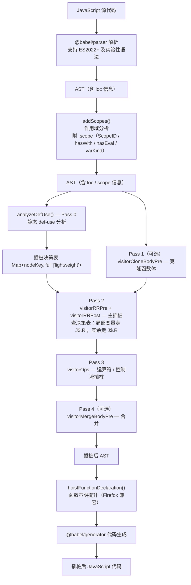
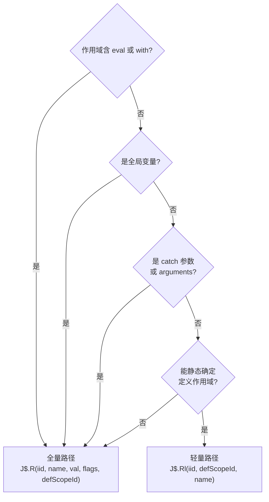
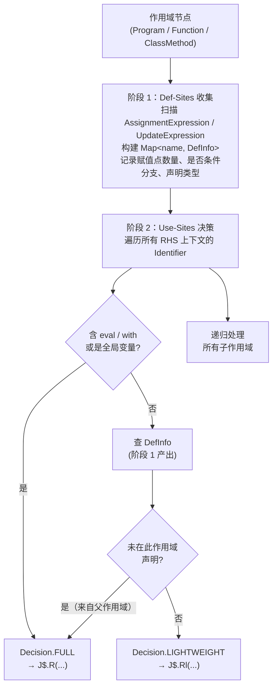

# 插桩引擎

源码位置：`src/instrument/`

## 概述

插桩引擎是 Jalangi2 的核心组件，负责将普通 JavaScript 源代码转换为带有分析钩子的插桩代码。
整个过程分为多个 Pass：**解析 → 作用域分析 → 静态 def-use 分析（Pass 0）→ AST 变换 → 代码生成 → 输出**。



## 对外 API

### `init(config, analysis?, sid?, jalangiVar?, plugins?)`

初始化插桩器，**必须在第一次调用 `instrumentCode` 之前调用**。

| 参数 | 类型 | 说明 |
|------|------|------|
| `config` | `object \| null` | Jalangi Config 对象，见 [Configuration.md](./Configuration.md)；若传 `null` 且提供 `plugins`，则自动推导 Config |
| `analysis` | `object?` | 当前分析对象（可选），用于 `instrumentCodePre` / `instrumentCode` 钩子 |
| `sid` | `*?` | 当前脚本 ID（eval 场景下的 source map） |
| `jalangiVar` | `string?` | 沙盒变量名，默认 `'J$'`，可自定义避免冲突 |
| `plugins` | `Array<string\|object>?` | 插件路径或实例列表；当 `config` 为 `null` 时，自动静态分析插件所用 Hook，生成最小化 Config |

```js
import { init } from './src/instrument/esnstrument.js';

// 方式一：手动传入 Config
init({
    INSTR_READ: null,         // null = 全部插桩
    INSTR_WRITE: null,
    ENABLE_SAMPLING: false,
    // ... 其余 Config 字段
});

// 方式二：传入 plugins，自动推导 Config（config 传 null）
init(null, undefined, undefined, undefined, ['./src/plugins/dlint/CheckNaN.js']);
```

### `instrumentCode(options)`

对代码字符串进行插桩，返回插桩结果对象。

#### 参数 `options`

| 字段 | 类型 | 默认值 | 说明 |
|------|------|--------|------|
| `code` | `string` | 必填 | 要插桩的 JS 源代码 |
| `origCodeFileName` | `string` | `'eval'` | 原始文件名（source map 用） |
| `instCodeFileName` | `string` | `'eval'` | 插桩后文件名 |
| `inlineSourceMap` | `boolean` | `false` | `true` → 将完整 iid→位置 map 内联到输出头部 |
| `inlineSource` | `boolean` | `false` | `true` → 将原始源码内联到 source map |
| `sourceType` | `'script'\|'module'` | `'script'` | ESM 模式支持顶层 await |
| `isEval` | `boolean` | `false` | 是否是 eval 动态代码 |
| `thisIid` | `number?` | — | eval 时的调用点 IID |
| `isDirect` | `boolean?` | — | eval 是否是直接调用 |
| `url` | `string?` | — | 脚本 URL（可选，写入 sourceMap） |

#### 返回值

```ts
{
    code:            string,   // 插桩后的代码字符串
    instAST:         object,   // 插桩后的 AST（可用于调试）
    sourceMapObject: object,   // iid → [startLine, startCol, endLine, endCol] 映射
    sourceMapString: string,   // sourceMapObject 的 JSON 字符串
}
```

#### 示例

```js
import { init, instrumentCode } from './src/instrument/esnstrument.js';

init({ ENABLE_SAMPLING: false });

const result = instrumentCode({
    code:             'var x = 1 + 2; console.log(x);',
    origCodeFileName: 'example.js',
    instCodeFileName: 'example_inst.js',
    inlineSourceMap:  true,
    sourceType:       'script',
});

console.log(result.code);           // 插桩后代码
console.log(result.sourceMapObject); // IID → 位置映射
```

### `instrumentEvalCode(code, iid, isDirect)`

eval 插桩的快捷包装，自动内联 source map 和原始代码。

```js
import { instrumentEvalCode } from './src/instrument/esnstrument.js';

const instrCode = instrumentEvalCode('var x = 1;', 42, true);
```

## 插桩变换详解

### 变量读写

变量读取有**两条路径**，插桩器在静态分析阶段决定走哪条：

**全量读取路径**（全局变量、含 `eval`/`with` 的作用域、`catch` 参数、`arguments`）：

```js
// 原始代码
x

// 插桩后（全量路径 — 含 scopeId 参数）
J$.R(iid, 'x', x, flags, defScopeId)
// 其中：flags = bitPattern(isGlobal, isScriptLocal)；全局变量无 defScopeId
```

**轻量读取路径**（静态可确认的局部变量：非全局、无 eval/with、非 catch 参数、非 arguments）：

```js
// 原始代码
x

// 插桩后（轻量路径 — 不传 value，运行时从 Shadow Frame 查值）
J$.Rl(iid, defScopeId, 'x')
```

变量写入（带 `scopeId` 参数，供运行时更新 Shadow Frame）：

```js
// 原始代码
x = expr

// 插桩后
J$.W(iid, 'x', expr, x, flags, defScopeId)
// 其中：flags = bitPattern(isGlobal, isScriptLocal, isDeclaration)
```

**读取路径决策流程**：



### 属性读写

```js
// 原始代码：点表达式
obj.prop
// 插桩后
J$.G(iid, obj, 'prop', flags)

// 原始代码：计算属性
obj[key]
// 插桩后
J$.G(iid, obj, J$.R(iid2, 'key', key, flags), flags)

// 原始代码：属性写入
obj.prop = val
// 插桩后
J$.P(iid, obj, 'prop', val, flags)
```

### 函数调用

```js
// 原始代码：普通函数调用
func(args)
// 插桩后
J$.F(iid, func, flags)(args)

// 原始代码：方法调用
obj.method(args)
// 插桩后
J$.M(iid, obj, 'method', flags)(args)
```

### 字面量

```js
// 原始代码 → 插桩后
42            → J$.T(iid, 42, J$.N_LOG_NUMBER_LIT, false)
'hello'       → J$.T(iid, 'hello', J$.N_LOG_STRING_LIT, false)
{}            → J$.T(iid, {}, J$.N_LOG_OBJECT_LIT, false)
[]            → J$.T(iid, [], J$.N_LOG_ARRAY_LIT, false)
function() {} → J$.T(iid, function() { J$.Fe(iid2, ...); ... J$.Fr(iid3); }, J$.N_LOG_FUNCTION_LIT, false)
```

### 二元/一元运算

```js
a + b  →  J$.B(iid, '+', a, b, flags)
!x     →  J$.U(iid, '!', x)
```

### 条件表达式

```js
// 原始代码
if (cond) { ... }
while (cond) { ... }
cond ? a : b

// 插桩后（test 部分）
if (J$.C(iid, cond)) { ... }
```

### 函数进入/退出

每个（非箭头）函数体自动注入。`J$.Fe` 第五个参数 `defScopeId` 为函数定义点的静态作用域 ID，供运行时创建 Shadow Frame：

```js
function foo(a, b) {
    // 插桩后头部（defScopeId = 函数所在 Scope 的 id，由插桩器静态注入）
    J$.Fe(iid, foo, this, arguments, defScopeId);
    try {
        // ... 原函数体（插桩后）
        return J$.Rt(iid2, returnVal);
    } finally {
        J$.Fr(iid3);
    }
}
```

> **注意**：箭头函数（`ArrowFunctionExpression`）没有独立的 `arguments` / `this`，
> 不注入 `J$.Fe` / `J$.Fr`，但仍然插桩其体内的所有表达式。

## IID（指令 ID）系统

每次 `instrumentCode` 调用前，`iid.js` 的 `initialize()` 会重置三个独立计数器：

| 计数器 | 用途 | 初始值 |
|--------|------|--------|
| `memIid` | 主计数器（R/W/G/P/F/M/T/N/Fe/Fr/Se/Sr） | `9`（eval: `13`） |
| `condIid` | 条件/switch 计数器（C/C1/C2） | `8`（eval: `12`） |
| `opIid` | 运算符计数器（B/U） | `10`（eval: `14`） |

**步长为 8**：同一 AST 节点的多个子操作共享一段 IID 空间：
- 方法调用：`iid`（主调用）、`iid+2`（内部 getField）

**源码位置映射**：每个 IID 对应一个 `[startLine, startCol, endLine, endCol]` 元组，
存储在 `iidSourceInfo` 对象中，最终作为 `sourceMapObject` 返回或内联到代码头部。

## 作用域分析

插桩前，`scope.js` 的 `addScopes()` 会对 AST 进行一遍预扫描，
为每个作用域节点（Program / Function / CatchClause）附加 `.scope` 属性。

### Scope 对象结构

```js
// scope.vars：变量名 → 声明类型（string）
scope.vars = {
    'x':   'var',    // var 声明
    'a':   'arg',    // 函数参数
    'foo': 'defun',  // 函数声明（function foo() {}）
    'bar': 'lambda', // 函数表达式（var bar = function() {}）
    'e':   'catch',  // catch 子句参数
}

// scope.varKinds：变量名 → 声明关键字（用于 const dead-read 消除等优化）
scope.varKinds = {
    'x':   'var',   // var 声明
    'y':   'let',   // let 声明
    'z':   'const', // const 声明（值不可变，可做 dead-read 消除）
}
```

### Scope 关键属性

| 属性/方法 | 说明 |
|-----------|------|
| `scope.id` | 本作用域的唯一整数 ID（每次 `instrumentCode` 重置，跨调用单调递增） |
| `scope.hasEval_` / `scope.usesEval()` | 作用域链内出现过 `eval` 标识符时为 `true`，禁用轻量读取路径 |
| `scope.hasWith_` / `scope.usesWith()` | 作用域链内出现过 `with` 语句时为 `true`，禁用轻量读取路径 |
| `scope.hasVar(name)` | 查询作用域链中是否存在该变量 |
| `scope.hasOwnVar(name)` | 仅查询本层作用域（用于 `_findDefScope` 遍历） |
| `scope.isGlobal(name)` | 判断变量是否为全局变量（设置 `isGlobal` 标志） |
| `scope.getVarKind(name)` | 获取变量的声明关键字（`'var'`/`'let'`/`'const'` 或 `undefined`） |

### 轻量路径判断条件（`_findDefScope`）

`wrappers.js` 的 `_findDefScope(scope, name)` 沿作用域链向上查找变量实际定义点（支持闭包），
并结合以下条件决定是否走轻量读取路径：

```
可以走 J$.Rl 轻量路径，当且仅当：
  1. defScope !== null（能静态确定定义点）
  2. !isGlobal（不是全局变量）
  3. !scope.usesEval()（作用域链无 eval）
  4. !scope.usesWith()（作用域链无 with）
  5. defScope.hasOwnVar(name) !== 'catch'（不是 catch 参数）
  6. name !== 'arguments'（不是 arguments 对象）
```

其余情况走 `J$.R` 全量路径，并携带 `defScopeId` 参数供运行时同步 Shadow Frame。

## 静态 Def-Use 分析（`dataflow.js`）

`src/instrument/dataflow.js` 实现了 **Pass 0 静态 SSA def-use 分析**，
在 `addScopes()` 之后、`transformAst()` 之前对原始 AST 执行，产出**插桩决策表**。

### 决策类型

| 决策 | 说明 | 对应插桩钩子 |
|------|------|-----------|
| `'full'` | 全量插桩（全局变量、含 eval/with、catch 参数等） | `J$.R(...)` |
| `'lightweight'` | 轻量插桩（静态确认的局部变量） | `J$.Rl(...)` |
| `'dead'` | 可省略的 dead read（当前保守实现降级为 lightweight，保留供未来扩展） | — |

### 分析算法（两阶段）



**阶段 1：Def-Sites 收集**

对每个函数作用域，扫描所有 `AssignmentExpression`、`UpdateExpression` 和变量声明，
构建 `Map<name, DefInfo>`，记录每个变量的赋值点数量、是否在条件分支内、声明类型（`const`/`let`/`var`/`param`）。

**阶段 2：Use-Sites 决策**

对每个 RHS 上下文的 Identifier：
- 作用域含 `eval`/`with` 或变量是全局变量 → `'full'`
- `const` 参数/无重赋值的 `param` → `'lightweight'`
- 有重赋值/多 def-site/条件赋值 → `'lightweight'`

### 使用方式

```js
import { analyzeDefUse, Decision } from './src/instrument/dataflow.js';

// 通常由 esnstrument.js 的 transformString 自动调用
const decisions = analyzeDefUse(ast);     // ast 已经过 addScopes 处理

// 查询某个 use-site 的决策
// nodeKey = `${scopeId}:${name}:${line}:${col}`
const key = `0:x:2:8`;
const decision = decisions.get(key);      // → 'full' | 'lightweight' | undefined
```

### 保守近似原则

宁可错判成 `lightweight`，也不错判成 `dead`：
- 变量被传入函数（可能被修改）→ `lightweight`
- 变量在 `try` 块内 → `lightweight`
- 作用域内有任何 `eval` 或 `with` → `full`

## 插件静态分析器（`pluginAnalyzer.js`）

`src/instrument/pluginAnalyzer.js` 提供**自动推导按需 Config** 的能力，
避免手动为每个插件维护 Config 对象。

### 对外 API

| 函数 | 说明 |
|------|------|
| `analyzePluginHooks(plugins)` | 从插件路径或实例提取使用的 Hook 名称集合 `Set<string>` |
| `buildConfigFromHooks(usedHooks)` | 根据 Hook 集合构建最小化 Config 对象 |
| `buildConfigFromPlugins(plugins)` | 两者的组合快捷函数 |
| `fullConfig()` | 返回全量插桩的 Config（所有字段均为 `null`）|


**Hook → Config 字段映射（摘要）**：

| Hook | 需要开启的 Config 字段 |
|------|---------------------|
| `read` | `INSTR_READ` |
| `write` | `INSTR_WRITE` |
| `getFieldPre` / `getField` | `INSTR_GETFIELD` |
| `putFieldPre` / `putField` | `INSTR_PUTFIELD` |
| `binaryPre` / `binary` | `INSTR_BINARY` |
| `unaryPre` / `unary` | `INSTR_UNARY` |
| `literal` | `INSTR_LITERAL` |
| `declare` | `INSTR_INIT`, `INSTR_TRY_CATCH_ARGUMENTS` |
| `conditional` | `INSTR_CONDITIONAL` |
| `functionEnter` / `functionExit` | `INSTR_TRY_CATCH_ARGUMENTS` |
| `endExpression` | `INSTR_END_EXPRESSION` |
| `invokeFunPre` / `invokeFun` | `INSTR_INVOKE` |
| `_return` | `INSTR_RETURN` |
| `_throw` | `INSTR_THROW` |
| `forinObject` | `INSTR_FORIN` |

### 示例

```js
import { buildConfigFromPlugins } from './src/instrument/pluginAnalyzer.js';
import { init, instrumentCode }  from './src/instrument/esnstrument.js';

// 自动分析插件，推导最小化 Config
const config = buildConfigFromPlugins(['./src/plugins/dlint/CheckNaN.js']);
init(config);

// 或通过 init() 直接传入 plugins（config 传 null）
init(null, undefined, undefined, undefined, ['./src/plugins/dlint/CheckNaN.js']);
```

## 输出格式

### script 模式

```js
// 输出结构（精简版）
(globalThis.J$ = globalThis.J$ || {});
J$.smap = J$.smap || {};
J$.smap["example_inst.js"] = { nBranches: 4, originalCodeFileName: "example.js", ... };
J$.iids = { nBranches: 4, originalCodeFileName: "example.js", ... };
(function(J$){
    // 插桩后的代码体
    // ...
}(typeof J$!=='undefined'?J$:{}));
// JALANGI DO NOT INSTRUMENT
```

### module 模式

```js
(globalThis.J$ = globalThis.J$ || {});
J$.smap = J$.smap || {};
J$.smap["example_inst.js"] = { ... };
J$.iids = { ... };
const J$ = globalThis.J$;
// 插桩后的代码体
// JALANGI DO NOT INSTRUMENT
```

### `// JALANGI DO NOT INSTRUMENT`

输出末尾自动追加此注释，防止已插桩的代码被二次插桩。
`instrumentCode` 在处理前会检查代码是否包含此注释，如果包含则直接跳过插桩。

## AST 遍历上下文（CONTEXT 枚举）

`astUtil.js` 中的 `CONTEXT` 枚举告知 visitor 当前节点的语义环境：

| 枚举值 | 场景 | 插桩行为 |
|--------|------|---------|
| `CONTEXT.RHS` | 右值（读取）| 插桩 R/G/T 等 |
| `CONTEXT.IGNORE` | 赋值左侧、标签名、解构 key | **不插桩** |
| `CONTEXT.METHOD` | class 方法的 FunctionExpression | 不包装为独立字面量 |
| `CONTEXT.GETTER` | getter 函数体 | 不包装为独立字面量 |
| `CONTEXT.SETTER` | setter 函数体 | 不包装为独立字面量 |
| `CONTEXT.TYPEOF` | `typeof x` 的操作数 | 插桩 R（不触发 ReferenceError）|
| `CONTEXT.OEXP` | ObjectExpression 属性列表 | 特殊处理 |
| `CONTEXT.PARAMS` | 函数形参 | 不插桩 |

## 模板缓存优化

`wrappers.js` 中的 `replaceInStatement(templateStr, ...args)` 函数：

1. 第一次调用时，用 `@babel/parser` 解析模板字符串并缓存 AST
2. 后续调用通过 `deepCloneAndReplace` 深拷贝缓存的 AST，替换占位符
3. 占位符格式：`J$_1`、`J$_2`（RP 前缀 = `"J$_"`，可随沙盒变量名变化）

这种方式避免了每次注入钩子都重新 parse，大幅提升大文件插桩性能。

## 采样模式（ENABLE_SAMPLING）

当 `Config.ENABLE_SAMPLING = true` 时，插桩器对每个函数体生成两个版本：

```js
function foo() {
    if (!J$.S(iid, arguments.callee)) {
        // 原始未插桩代码（bodyOrig）
    } else {
        // 插桩后代码
    }
}
```

`J$.S(iid, callee)` 由运行时决定是否对该次调用执行插桩版本，
实现基于采样率的性能优化。
