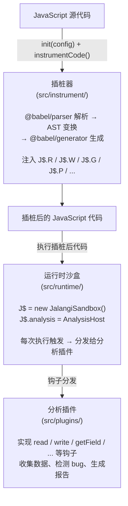
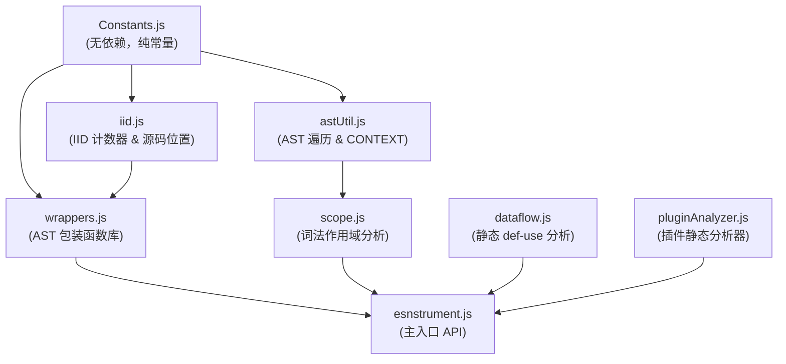
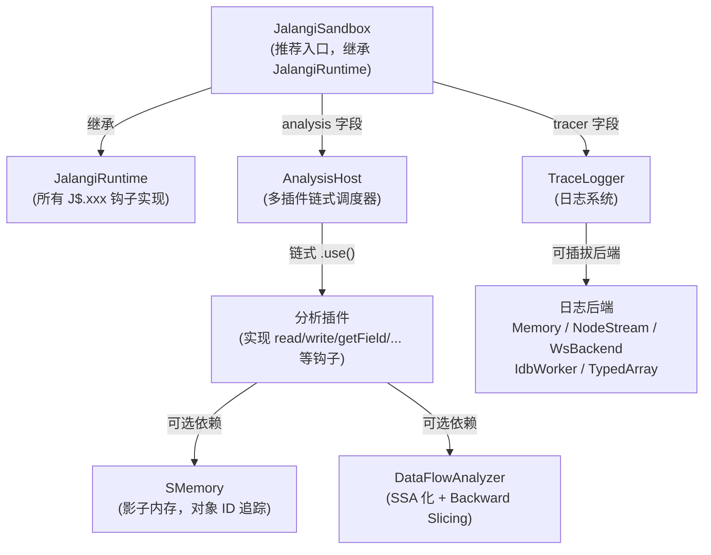

# Jalangi2 概览

## 项目简介

Jalangi2 是一个面向 JavaScript 的**动态分析框架**，核心功能是对 JS 源代码进行 AST 插桩（Instrumentation），
在关键操作（读写变量、属性访问、函数调用、运算符、字面量等）前后注入分析钩子，
从而在运行时收集程序行为数据，用于 bug 检测、覆盖率统计、污点分析等场景。

**目标环境**：浏览器 + Node.js 均支持。插桩器核心（`src/instrument/`）为纯 ESM，
不依赖任何平台 API，可在两种环境中直接使用。

## 系统架构

Jalangi2 的整体流程分为三个阶段：



## 核心模块

### 插桩器（`src/instrument/`）

| 模块 | 职责 |
|------|------|
| `esnstrument.js` | 主入口，`init()` + `instrumentCode()` 对外 API |
| `astUtil.js` | AST 遍历器与 CONTEXT 上下文枚举 |
| `scope.js` | 词法作用域分析，含 ScopeID / eval / with 检测 / varKind |
| `iid.js` | IID（Instruction ID）计数器与源码位置映射 |
| `wrappers.js` | AST 节点包装函数库，模板缓存优化 |
| `dataflow.js` | 静态 SSA def-use 分析，生成插桩决策表（Pass 0）|
| `pluginAnalyzer.js` | 插件静态分析器，自动推导按需 Config（`buildConfigFromPlugins`）|

**模块依赖关系**：



### 运行时（`src/runtime/`）

| 模块 | 职责 |
|------|------|
| `JalangiRuntime.js` | 所有 J$ 钩子函数的核心实现（基类），含 OID、ContextID、Shadow Frame |
| `JalangiSandbox.js` | 完整沙盒对象，继承 `JalangiRuntime`（推荐使用） |
| `AnalysisHost.js` | 多插件链式调度器，`.use()` 注册分析 |
| `SMemory.js` | Shadow Memory 影子内存服务，为对象关联唯一 ID |
| `analysisCallbackTemplate.js` | 分析插件接口模板（`AnalysisTemplate` 基类） |
| `DataFlowAnalyzer.js` | 运行时 SSA 数据流分析器，消费 log 条目，支持 backward slicing |
| `AntiDetection.js` | 反插桩对抗工具，`toString` Hook / 全局变量检测 / 异步上下文包装 |
| `logging/backends/TypedArrayBackend.js` | 高性能 TypedArray 环形缓冲区日志后端，零 GC、高吞吐量 |

**运行时组件关系**：



## 插桩钩子一览

插桩器将以下 JavaScript 操作替换为对应的 `J$.xxx()` 钩子调用：

| 钩子 | 触发场景 | 对应分析回调 |
|------|---------|-------------|
| `J$.R(iid, name, val, flags, defScopeId?)` | 变量读取（全量路径，含 Shadow Frame 同步） | `read` |
| `J$.Rl(iid, defScopeId, name)` | 变量读取（**轻量路径**，从 Shadow Frame 查值，不传 value） | `read` |
| `J$.W(iid, name, val, lhs, flags, defScopeId?)` | 变量写入（兼更新 Shadow Frame） | `write` |
| `J$.G(iid, base, offset, flags)` | 属性读取 | `getFieldPre` / `getField` |
| `J$.P(iid, base, offset, val, flags)` | 属性写入 | `putFieldPre` / `putField` |
| `J$.F(iid, f, flags)` | 函数调用 | `invokeFunPre` / `invokeFun` |
| `J$.M(iid, base, offset, flags)` | 方法调用 | `invokeFunPre` / `invokeFun` |
| `J$.T(iid, val, type, hasGS)` | 字面量创建 | `literal` |
| `J$.B(iid, op, left, right, flags)` | 二元运算 | `binaryPre` / `binary` |
| `J$.U(iid, op, left)` | 一元运算 | `unaryPre` / `unary` |
| `J$.C(iid, cond)` | 条件判断 | `conditional` |
| `J$.Fe(iid, f, dis, args, defScopeId?)` | 函数进入 | `functionEnter` |
| `J$.Fr(iid)` | 函数退出 | `functionExit` |
| `J$.Se(iid, val, origFile)` | 脚本进入 | `scriptEnter` |
| `J$.Sr(iid)` | 脚本退出 | `scriptExit` |
| `J$.N(iid, name, val, flags)` | 变量声明初始化 | `declare` |
| `J$.Aw(iid)` | `await` 恢复点，通知运行时当前异步上下文已恢复 | — |

## 技术栈

| 依赖 | 用途 |
|------|------|
| `@babel/parser ^7.29` | JavaScript 解析器，支持 ES2022+、TS/Flow 及实验性语法 |
| `@babel/generator ^7.29` | 代码生成器，支持 Babel 原生 AST |

> **注意**：旧版使用 `acorn + astring`，当前已完全迁移到 `@babel/parser + @babel/generator`。

## 模块系统

本项目使用标准 **ESM**（`"type": "module"` in `package.json`），所有 `src/instrument/` 下的文件均为纯 ESM 模块，支持 `import` / `export`，无全局污染。

## 使用方式

### 1. 纯插桩（不运行）

适合预处理构建管线，或在 Node.js 中以编程方式生成插桩代码：

```js
import { init, instrumentCode } from './src/instrument/esnstrument.js';

const Config = { ENABLE_SAMPLING: false };  // 其余字段 null = 全部插桩
init(Config);

const { code, sourceMapObject } = instrumentCode({
    code:             'var x = 1; console.log(x);',
    origCodeFileName: 'example.js',
    instCodeFileName: 'example_inst.js',
    inlineSourceMap:  true,   // 将 IID→位置 map 内联到输出头部
    sourceType:       'script',
});
```

### 2. 按需插桩（自动推导 Config）

```js
import { init, instrumentCode } from './src/instrument/esnstrument.js';

// 不传 config，改传 plugins：自动静态分析插件所用 Hook，生成最小化 Config
init(null, undefined, undefined, undefined, ['./src/plugins/dlint/CheckNaN.js']);

const result = instrumentCode({ code: src, origCodeFileName: 'foo.js', instCodeFileName: 'foo_inst.js' });
```

### 3. 插桩 + 运行时分析

```js
// 1. 初始化沙盒
import { JalangiSandbox } from './src/runtime/JalangiSandbox.js';
const J$ = globalThis.J$ = new JalangiSandbox();

// 2. 注册分析插件
import { MyAnalysis } from './myAnalysis.js';
J$.analysis.use(new MyAnalysis(J$));

// 3. 插桩并执行代码（通常通过 bin/jalangi.mjs）
```

### 4. 命令行工具

```bash
# 插桩单个文件
node bin/instrument.mjs input.js

# 运行分析
node bin/jalangi.mjs --analysis src/plugins/tutorial/LogAll.js target.js

# 为浏览器端插桩
node bin/instrument-for-browser.mjs input.js

# 启动 Trace Server（浏览器端事件收集）
npm run trace-server
```

## 设计亮点

1. **无全局污染**：插桩代码用 IIFE 包裹，沙盒变量名（默认 `J$`，可自定义）通过闭包传入
2. **可选 module 模式**：`sourceType: 'module'` 支持 ESM 插桩（顶层 await）
3. **模板缓存**：`wrappers.js` 中 `replaceInStatement` 对模板 Babel AST 结果缓存，大幅提升性能
4. **IID 步长 8**：同一 AST 节点的多个子操作共享一段 IID，如方法调用 `iid+2` 为内部 getField
5. **采样模式**：`ENABLE_SAMPLING: true` 时，每个函数在"插桩版本"和"原始版本"之间动态切换
6. **作用域感知插桩**：`scope.js` 为每个词法作用域分配唯一 `ScopeID`，`J$.W` / `J$.Fe` 传递 `defScopeId`，精确区分同名变量
7. **Shadow Frame + 轻量读取**：运行时按 `(defScopeId, callId)` 缓存变量值；对静态可信局部变量改用 `J$.Rl` 不传值路径，大幅降低代码膨胀
8. **CallID 递归隔离**：`J$.Fe` 每次函数进入生成新 `callId`，递归调用与并发任务的 Shadow Frame 互不干扰
9. **对象 OID 机制**：`J$.T` 字面量创建时为引用类型分配全局唯一 OID，通过 `J$.P` 写属性时自动递增版本号，支持别名追踪
10. **异步 ContextID**：`J$.Aw` 恢复点钩子 + `newAsyncContext()` / `activateContext()` API，彻底解决异步 log 交叉感染问题
11. **静态 SSA def-use 分析**：`dataflow.js` 在插桩前对 AST 进行两阶段分析，生成插桩决策表（FULL / LIGHTWEIGHT / DEAD），指导第三 AST Pass 选择最优钩子
12. **按需 Config 推导**：`pluginAnalyzer.js` 静态扫描插件代码，自动推导最小化插桩 Config，减少不必要的插桩开销
13. **高性能日志后端**：`TypedArrayBackend` 使用 `Float64Array` 环形缓冲区，单条写入无 GC，峰值吞吐量显著优于普通对象数组
14. **反插桩对抗**：`AntiDetection` 提供 `Function.prototype.toString` Hook、全局泄露检测、异步上下文包装等隐蔽性增强机制
