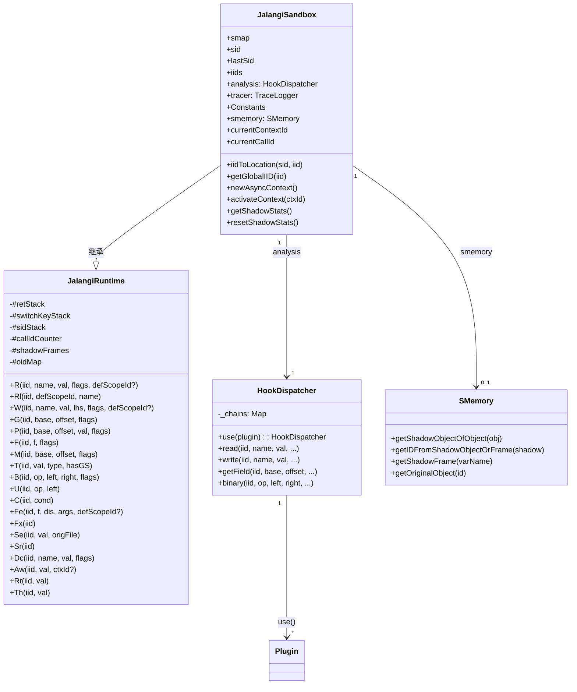
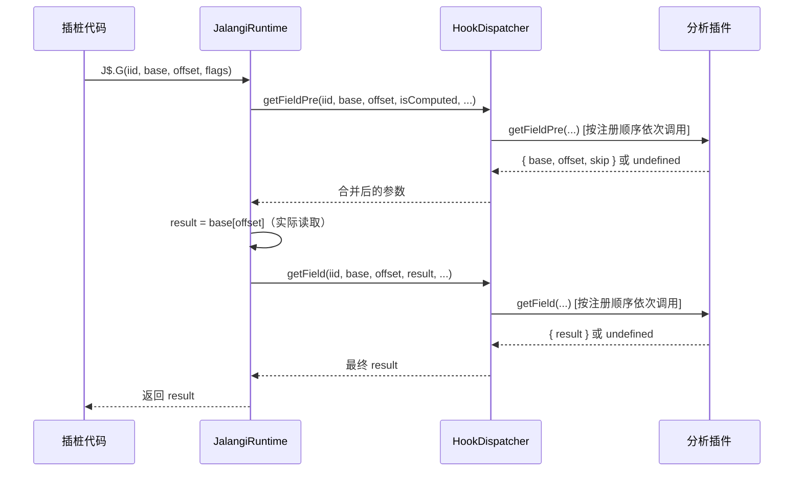
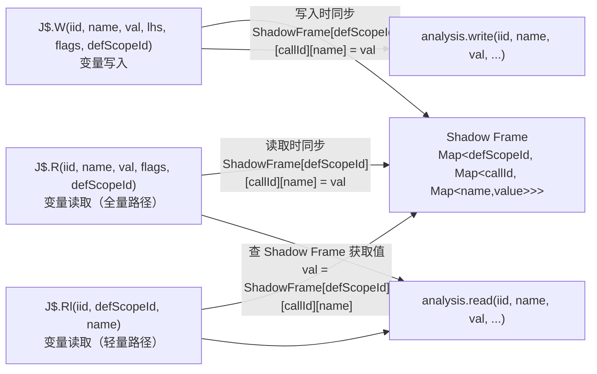
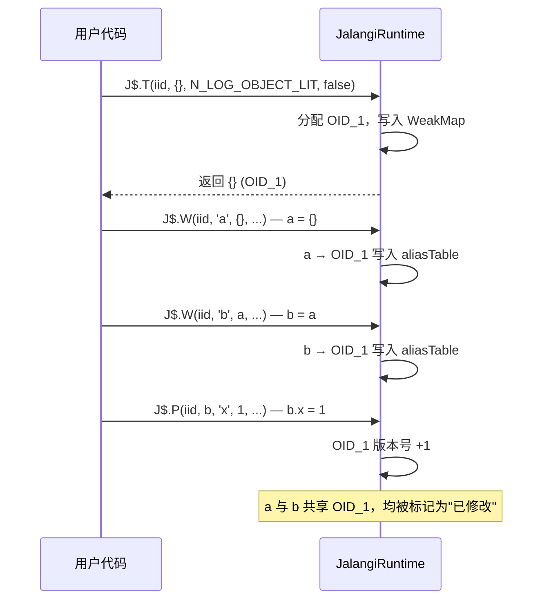
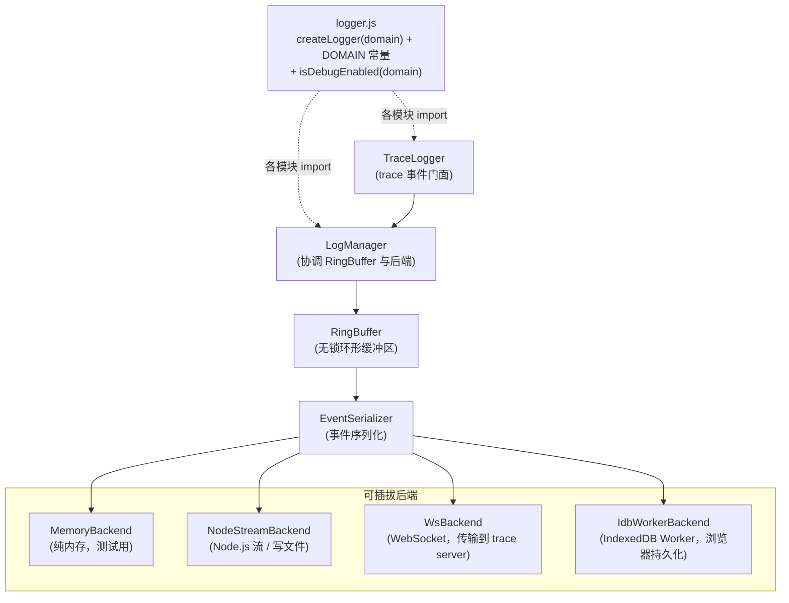
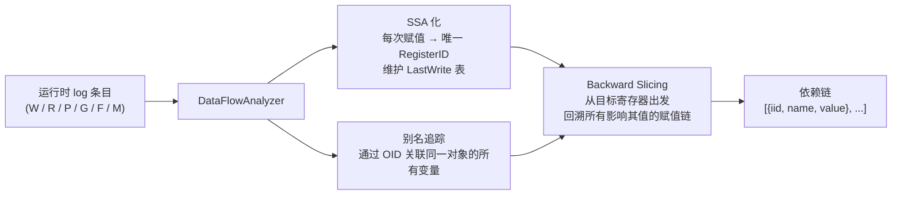

# 运行时系统

源码位置：`src/runtime/`

## 概述

运行时系统负责接收插桩代码在执行时发出的 `J$.xxx()` 调用，并将它们分发给已注册的分析插件。
主要包含以下组件：

| 组件 | 文件 | 职责 |
|------|------|------|
| `JalangiRuntime` | `JalangiRuntime.js` | 所有 J$ 钩子函数的核心实现（基类） |
| `JalangiSandbox` | `JalangiSandbox.js` | 完整沙盒对象，继承 JalangiRuntime（**推荐使用**） |
| `HookDispatcher` | `HookDispatcher.js` | 多插件链式调度器 |
| `SMemory` | `SMemory.js` | Shadow Memory 影子内存服务 |
| `AnalysisTemplate` | `analysisCallbackTemplate.js` | 分析插件接口基类模板 |
| `DataFlowAnalyzer` | `DataFlowAnalyzer.js` | 运行时 SSA 数据流分析器，支持 backward slicing |
| `AntiDetection` | `AntiDetection.js` | 反插桩对抗工具 |
| `NativeProxy` | `NativeProxy.js` | 原生方法快照，防止 monkey-patch 导致的递归栈溢出 |

**运行时组件层次**：



## JalangiSandbox — 完整沙盒

> **推荐**：使用静态异步工厂方法 `JalangiSandbox.create(options)` 创建实例，
> 而非直接 `new JalangiSandbox()`，以确保异步插件（如 ExecutionTraceAnalysis）在使用前已完全注册，避免早期 trace 事件丢失。

```js
import { JalangiSandbox } from './src/runtime/JalangiSandbox.js';

// 推荐方式：使用 create() 异步工厂方法
const J$ = globalThis.J$ = await JalangiSandbox.create();
J$.analysis.use(new MyAnalysis(J$));

// 带 ExecutionTrace 的完整用法
const J$ = globalThis.J$ = await JalangiSandbox.create({
    withExecutionTrace: true,
    useIdb:    true,
    dbName:    'jalangi-traces',
    storeName: 'execution-trace',
});

// 纯观测模式（插件无法修改执行结果）
const J$ = globalThis.J$ = await JalangiSandbox.create({ observeOnly: true });

// 同步创建（不需要异步插件时仍可用 new，但需要手动 await）
const J$ = globalThis.J$ = new JalangiSandbox();
J$.analysis.use(new MyAnalysis(J$));

// 扩展：追加更多分析插件
J$.analysis.use(new AnotherAnalysis(J$));
```

### 构造参数

| 参数 | 类型 | 默认值 | 说明 |
|------|------|--------|------|
| `useIdb` | `boolean` | `false` | 浏览器中是否启用 IndexedDB 持久化 |
| `dbName` | `string` | — | IndexedDB 数据库名 |
| `storeName` | `string` | — | IndexedDB ObjectStore 名 |
| `withExecutionTrace` | `boolean` | `false` | 是否自动注册内置 ExecutionTraceAnalysis 插件 |
| `sourceCode` | `string` | — | 原始源码（ExecutionTrace 用，可选） |
| `debugShadow` | `boolean` | `false` | 是否开启 Shadow Frame 调试模式。开启后每次 `Rl()` 查表未命中时，递增 miss 计数器并写入 miss 日志，同时向 `console.warn` 输出诊断信息。可通过 `getShadowStats()` 查询结果 |
| `observeOnly` | `boolean` | `false` | 纯观测模式。`true` 时所有插件钩子仍正常调用，但返回值被完全忽略——插件无法通过 `result`/`skip`/`isBacktrack` 等字段修改原始程序的执行。适用于 Trace / Coverage / Profiling 等纯观测场景 |
| `instrumentEval` | `boolean` | `false` | 是否对 `eval` / `new Function` 动态创建的代码进行插桩。默认 `false`：eval/Function 直接透传原始调用，语义完全保持原样。设为 `true` 则恢复旧式行为（动态代码也被插桩分析） |

### 公开字段与 Getter

| 字段/Getter | 类型 | 说明 |
|------|------|------|
| `smap` | `object` | iid → 源码位置映射表 `{ [sid]: { [iid]: [sl,sc,el,ec] } }` |
| `sid` | `number` | 当前脚本 ID（`Sr()` 执行后会回滚，脚本结束后为 0） |
| `lastSid` | `number` | 最后执行的脚本 ID（不随 `Sr()` 回滚，脚本执行完成后仍可用于查询位置映射）|
| `iids` | `object\|null` | 当前脚本的 iid 映射（由插桩代码在 Se() 前写入） |
| `analysis` | `HookDispatcher` | 当前分析插件调度器，支持 `.use()` 链式注册 |
| `tracer` | `TraceLogger\|null` | TraceLogger 实例（由 ExecutionTraceAnalysis 写入） |
| `Constants` | `object` | 所有全局常量（APPLY、CALL、HOP、JALANGI_VAR 等） |
| `smemory` | `SMemory\|null` | Shadow Memory 实例（启用后由 SMemoryPlugin 写入） |
| `currentCallId` | `number`（getter）| 当前函数调用帧的唯一 ID（0 = 顶层脚本作用域），可供分析器查询以区分同一函数的不同调用实例 |
| `currentContextId` | `number`（getter）| 当前激活的异步上下文 ID（0 = 顶层同步代码）|

### 位置查询

`iidToLocation(sid, iid)` 接受脚本 ID 和指令 ID，返回可读的源码位置字符串。
也接受 `"sid:iid"` 格式的全局 IID 字符串作为第一个参数（此时第二个参数可省略）。

```js
// 根据 (sid, iid) 获取源码位置（推荐，常用于 analysis 回调中）
const loc = J$.iidToLocation(J$.lastSid, iid);
// → "(example.js:3:5:3:15)"

// 也接受 "sid:iid" 格式的全局 IID 字符串
const loc2 = J$.iidToLocation('1:42');
// → "(example.js:1:1:1:10)"

// 获取全局唯一 IID（含 sid 前缀）
const globalIid = J$.getGlobalIID(iid);
// → "1:42"
```

> **注意**：旧文档中的 `J$.iidToLocation(iid)` 单参数用法是错误的。
> `iidToLocation` 需要两个参数 `(sid, iid)`，或一个 `"sid:iid"` 格式字符串。
> 在 analysis 回调中常通过 `J$.lastSid` 获取当前脚本 ID。

## JalangiRuntime — 钩子实现

`JalangiRuntime` 是 `JalangiSandbox` 的父类，实现了所有 `J$.xxx()` 钩子方法。

### 钩子函数列表

每个钩子由插桩代码调用，内部执行"pre → 执行操作 → post"的三段式模式：

| 钩子 | 触发场景 | 分析回调 |
|------|---------|---------|
| `R(iid, name, val, flags, defScopeId?)` | 变量读取（全量路径，兼更新 Shadow Frame） | `read(iid, name, val, isGlobal, isScriptLocal)` |
| `Rl(iid, defScopeId, name)` | 变量读取（**轻量路径**，从 Shadow Frame 查值） | `read(iid, name, val, false, false)` |
| `W(iid, name, val, lhs, flags, defScopeId?)` | 变量写入（兼更新 Shadow Frame） | `write(iid, name, val, lhs, isGlobal, isScriptLocal)` |
| `G(iid, base, offset, flags)` | 属性读取 | `getFieldPre` → `getField` |
| `P(iid, base, offset, val, flags)` | 属性写入 | `putFieldPre` → `putField` |
| `F(iid, f, flags)` | 函数调用 | `callPre` → `call` |
| `M(iid, base, offset, flags)` | 方法调用 | `callPre` → `call` |
| `T(iid, val, type, hasGS)` | 字面量创建 | `literal` |
| `B(iid, op, left, right, flags)` | 二元运算 | `binaryPre` → `binary` |
| `U(iid, op, left)` | 一元运算 | `unaryPre` → `unary` |
| `C(iid, cond)` | 条件判断 | `conditional` |
| `C1(iid, val)` | switch 键值 | — |
| `C2(iid, val)` | case 标签值 | — |
| `Fe(iid, f, dis, args, defScopeId?)` | 函数进入（分配 CallID，创建 Shadow Frame） | `functionEnter` |
| `Fx(iid)` | 函数退出（弹出 CallID 栈，清除 Shadow Frame） | `functionExit` |
| `Se(iid, val, origFile)` | 脚本进入（同时记录 `J$.lastSid`，不随 `Sr()` 回滚） | `scriptEnter` |
| `Sr(iid)` | 脚本退出（回滚 `sid`，但 `lastSid` 保留，可在脚本完成后仍能查询位置映射） | `scriptExit` |
| `Dc(iid, name, val, flags)` | 变量声明 | `declare` |
| `Rt(iid, val)` | return 值 | `returnStmt` |
| `Th(iid, val)` | throw 值 | `throwStmt` |
| `Wt(iid, val)` | with 对象 | `withStmt` |
| `Fi(iid, val)` | for-in 对象 | `forIn` |
| `Xe(iid, val)` | 表达式语句末尾 | `endExpression` |
| `Aw(iid, val, ctxId?)` | await 恢复点（透传 resolved value，更新 `#currentContextId`） | `awaitResume(iid, contextId, val)` |

### 钩子执行三段式（以 G / getField 为例）



### flags 位字段

`flags` 是一个整数，通过位字段编码多个布尔值，可用 `decodeBitPattern` 解码：

- `R` 的 flags：`[isGlobal, isScriptLocal]`；可选第五参数 `defScopeId`（插桩器静态注入）
- `W` 的 flags：`[isGlobal, isScriptLocal, isDeclaration]`；可选第六参数 `defScopeId`
- `Fe` 的可选第五参数：`defScopeId`（函数定义点的 Scope.id）
- `G` 的 flags：`[isComputed, isOpAssign, isMethodCall, isOptional]`（第 4 位 `isOptional=1` 时为可选链 `?.`，`base` 为 `null`/`undefined` 直接短路返回 `undefined`）
- `P` 的 flags：`[isComputed, isOpAssign]`
- `F` / `M` 的 flags：`[isConstructor, isMethod]`

## HookDispatcher — 多插件调度器

`HookDispatcher` 管理多个分析插件，并将每个钩子依次分发给所有注册了该钩子的插件。

```js
import { HookDispatcher } from './src/runtime/HookDispatcher.js';

const host = new HookDispatcher();

// 注册多个插件（链式调用）
host.use(new SMemoryPlugin(smemory))
    .use(new LogAllAnalysis(smemory))
    .use(new MyCustomAnalysis());
```

### 支持的钩子名称

```
returnStmt, throwStmt, withStmt,
awaitResume,
binaryPre, binary, conditional,
declare, endExecution, endExpression,
forIn, functionEnter, functionExit,
getFieldPre, getField, instrumentCodePre,
instrumentCode, callPre, call,
literal, onReady, putFieldPre,
putField, read, shouldInstrumentFn,
scriptEnter, scriptExit, unaryPre,
unary, write
```

### 参数传递机制

`HookDispatcher` 支持两种插件间数据传递方式：

1. **全量 args 替换**：若插件返回含 `args` 字段（Array 类型）的对象，后续插件将使用该新参数数组。

2. **精确 result 传递**（推荐）：若插件仅返回 `{ result }` 对象，调度器会根据内置的 `RESULT_ARG_INDEX` 表自动将 `result` 更新到对应参数位置，后续插件可直接看到修改后的值。支持的钩子及其 `result` 位置如下：

| 钩子 | result 在 args 中的位置（0-based） |
|------|------------------------------------|
| `binary` | 4（binary(iid, op, left, right, **result**, ...)）|
| `unary` | 2（unary(iid, op, **val**, ...)）|
| `write` | 2（write(iid, name, **val**, ...)）|
| `read` | 2（read(iid, name, **val**, ...)）|
| `getField` | 3（getField(iid, base, offset, **val**, ...)）|
| `putField` | 3（putField(iid, base, offset, **val**, ...)）|
| `call` | 4（call(iid, f, base, args, **result**, ...)）|
| `literal` | 1（literal(iid, **val**, ...)）|
| `conditional` | 1（conditional(iid, **result**, ...)）|
| `forIn` | 1（forIn(iid, **val**, ...)）|
| `declare` | 2（declare(iid, name, **val**, ...)）|
| `returnStmt` | 1（returnStmt(iid, **val**, ...)）|
| `throwStmt` | 1（throwStmt(iid, **val**, ...)）|

### 错误处理

当插件 hook 抛出异常时，`HookDispatcher` 会调用 `onError(hookName, error)` 进行处理，
随后重新抛出原始异常，确保调用栈不被截断。

```js
const host = new HookDispatcher({
    onError: (hookName, error) => {
        console.error(`[${hookName}] Plugin error:`, error);
        // 自定义错误处理，如测试时阻止 process.exit
    },
});
```

> **实现细节**：`_makeDispatcher` 内部通过惰性读取 `() => this._onError` 支持构造后替换
> `_onError`（动态更新错误处理器）。调用时先 `const handler = onError()` 取出处理器，
> 再 `if (typeof handler === 'function') handler(name, e)` 安全调用，防止 `_onError`
> 被意外设为非函数时产生掩盖原始异常的二次 `TypeError`。

## SMemory — 影子内存

`SMemory` 为每个 JavaScript 对象、函数和活动帧维护一个"影子对象"和唯一 ID，
使分析插件可以将任意元数据附加到 JS 对象上，而不修改原对象本身。

```js
import { SMemory, SMemoryPlugin } from './src/runtime/SMemory.js';

const smemory = new SMemory(J$);
// 通过 SMemoryPlugin 将其与运行时事件桥接
J$.analysis.use(new SMemoryPlugin(smemory));

// 现在可以通过 J$.smemory 访问影子内存
```

> **向后兼容模式**：`SMemory.js` 模块底部保留了旧式自动安装代码（`--analysis SMemory.js` 直接加载时生效）。
> 该代码通过 `globalThis.J$`（而非裸 `J$`）检测沙盒是否存在，在 ESM / CJS / 浏览器等
> 所有环境下语义一致。若 `J$.analysis` 已是 `HookDispatcher`（支持 `.use()`），
> 则以插件方式集成（不覆盖现有分析）；否则直接赋值（兼容旧式单一分析）。

### 主要 API

```js
// 获取对象的影子对象（自动创建）
const shadow = smemory.getShadowObjectOfObject(obj);

// 获取影子对象/帧的唯一 ID
const id = smemory.getIDFromShadowObjectOrFrame(shadow);

// 获取当前活动帧的影子帧
const frame = smemory.getShadowFrame(varName);

// 通过 ID 反向查找原始对象
const orig = smemory.getOriginalObject(id);
```

### 影子对象属性键

影子内存使用特殊的隐藏属性键存储元数据，避免与用户代码冲突：

```
*J$O*   → 影子对象引用
*J$F*   → 影子帧标记
*J$A*   → 原始对象反向引用
```

## CallID 机制与 Shadow Frame（轻量变量读取）

### CallID

`JalangiRuntime` 为每次函数调用分配一个唯一的 **CallID**（整数，全局单调递增），
解决同一函数在递归、闭包、异步并发场景下局部变量的区分问题：

- `Fe(iid, f, dis, args, defScopeId)` — 分配新 CallID，将 `(旧 callId, defScopeId)` 压栈
- `Fx(iid)` — 弹出栈顶，恢复调用方的 CallID，同时清除本次调用的 Shadow Frame

### Shadow Frame

`JalangiRuntime` 内部维护一张 **Shadow Frame 映射表**，结构为嵌套的 `Map<number, Map<number, Map>>`（即 `defScopeId -> callId -> Map<name, value>`）。
每个条目是 `Map<name, value>`。其作用是让 `J$.Rl` 轻量读取钩子能够在不接收 `value` 参数的情况下，
仍能正确获取变量当前值，避免将变量值通过表达式传递（减少插桩开销）。

**数据流向**：



**适用条件**（插桩器静态判断）：局部变量、无 `eval`/`with`、非 `catch` 参数、非 `arguments`、**非箭头函数参数**（箭头函数无 `Fe`/`Fx` 钩子，Shadow Frame 不会初始化其形参，因此强制走全量 `R` 路径）。

### Shadow Frame 内存管理与闭包

当函数退出（`Fx`）时，通常会清除其对应的 Shadow Frame。但如果该函数内创建了闭包，闭包可能会在未来访问这些局部变量。
为了解决这个问题，`JalangiRuntime` 引入了 **闭包引用计数** 和 **垃圾回收注册表（FinalizationRegistry）**：
1. 在 `T`（字面量创建）钩子中，如果创建的是函数（闭包），则将其外层帧的 `(defScopeId, callId)` 记录到 `#closureFrameSet`，并递增引用计数。
2. `Fx` 退出时，如果当前帧在 `#closureFrameSet` 中，则**不清除** Shadow Frame。
3. 将闭包函数注册到 `FinalizationRegistry`。当闭包函数被 JS 引擎垃圾回收时，自动递减引用计数；当计数归零时，安全地清理对应的 Shadow Frame，防止内存泄漏。

### Shadow Frame 诊断 API

`JalangiRuntime` 内部使用 **Sentinel 哨兵对象**（`_SHADOW_MISS`）区分两种情况：

- `#shadowLookup` 返回哨兵 → 该变量**从未被写入** Shadow Frame（真正的缺失，可能是写入路径漏插桩或 `callId` 对不上）
- `#shadowLookup` 返回普通值（含 `undefined`）→ 变量值本身就是 `undefined`

过去这两种情况无法区分，`Rl()` 在两者均会静默返回 `undefined` 并影响被分析代码的实际运行结果。引入哨兵后，所有真正的缺失均可被观测到。

```js
// 开启调试模式
const J$ = new JalangiSandbox({ debugShadow: true });

// ... 运行被分析代码 ...
// 每次 Rl() 查表未命中，console.warn 会实时打印：
// [Jalangi] Shadow Frame MISS: name="x" iid=42 defScopeId=3 callId=7 — ...

// 执行完毕后查询统计
const stats = J$.getShadowStats();
// stats.missCount   → 总 miss 次数（总是可用，与 debugShadow 无关）
// stats.missLog     → 每次 miss 的详细记录（仅 debugShadow=true 时有内容）
// stats.frameCount  → 当前存活的 Shadow Frame 帧数（调试内存泄漏用）
// stats.debugShadow → 是否处于调试模式

// 用 iidToLocation 将 iid 转成源码位置（需传入 lastSid 和 iid）
stats.missLog.forEach(({ iid, name }) => {
    console.log(`  ${name} @ ${J$.iidToLocation(J$.lastSid, iid)}`);
});

// 多轮测试之间清空状态
J$.resetShadowStats();
```

> **注意**：生产环境下 `debugShadow` 默认为 `false`，miss 计数器仍然递增（开销极低），
> 但 `missLog` 为空，不写日志，不调用 `console.warn`。
> 只有在需要定位问题时才开启 `debugShadow: true`。

## 对象 OID 机制

`JalangiRuntime` 为每个对象/数组/函数分配唯一的 **OID（Object ID）**，支持别名追踪和对象版本管理：

- **分配时机**：`J$.T()`（字面量创建）时，通过 `WeakMap` 为引用类型对象分配 OID
- **别名记录**：`J$.W()` 中，当右值是对象时，记录 `"scopeId:callId:name" → OID` 的映射
- **版本递增**：`J$.P()`（属性写入）时，对 base 对象的 OID 版本号 +1

### 公开 API

```js
// 查询对象的 OID（不分配新 OID）
const oid = J$.getOid(obj);           // → number | null

// 查询对象的版本号（每次 putField 递增）
const ver = J$.getObjectVersion(obj); // → number（0 = 从未被修改）
```

### 别名追踪示例



## 异步 ContextID 机制

`JalangiRuntime` 为不同的异步任务分配独立的 **ContextID**，解决异步 log 交叉感染问题：

- **顶层同步代码**：ContextID = 0
- **async function / setTimeout 等**：通过 `newAsyncContext()` 分配新 ContextID

### 公开 API

```js
// 查询当前异步上下文 ID
const ctxId = J$.currentContextId;   // → number（0 = 顶层同步）

// 为新异步任务分配 ContextID
const newCtxId = J$.newAsyncContext(); // → number（唯一递增）

// 激活指定的异步上下文（在回调入口调用）
J$.activateContext(newCtxId);
```

### await 恢复点钩子（`J$.Aw`）

插桩器将 `await expr` 改写为 `J$.Aw(iid, await expr, J$__ctx)`：

```js
// 插桩代码（由 wrappers.js 手工构造 AST 生成）
J$.Aw(iid, await expr, J$__ctx)
// J$__ctx 是 async 函数入口注入的局部变量：
//   var J$__ctx = J$.currentCallId;
// 用于在并发 async 调用时正确区分不同调用实例的 contextId。
```

**运行时处理流程**：
1. JS 引擎在 `await expr` 处挂起协程，Promise 就绪后恢复
2. resolved value 作为 `val` 参数传入 `Aw()`
3. `Aw()` 将 `#currentContextId` 设为 `ctxId`（若提供）或 `#currentCallId`（兜底）
4. `Aw()` 调用 `analysis.awaitResume(iid, contextId, val)`
5. `Aw()` 返回 `val`，语义完全保留

分析插件可通过 `awaitResume(iid, contextId, val)` 回调监听 await 恢复事件（详见 [Analysis-Development.md](./Analysis-Development.md)）。

### 包装异步回调（结合 AntiDetection.js）

```js
import { createContextWrapper } from './src/runtime/AntiDetection.js';

// 确保 setTimeout 回调在独立异步上下文中运行
setTimeout(createContextWrapper(originalCallback, J$), delay);
```

## 脚本 ID 管理

运行时维护 `sidStack`（脚本 ID 栈）以支持多脚本/eval 嵌套执行：

1. `J$.Se(iid, val, origFile)` —— 脚本进入时推入新 sid，注册 smap 中的映射
2. `J$.Sr(iid)` —— 脚本退出时弹出 sid，恢复父脚本上下文

```js
// 源码位置查询示例（需传入 sid 和 iid 两个参数）
J$.iidToLocation(J$.lastSid, iid);
// → "(example.js:3:5:3:15)"
```

## eval 和 Function 动态代码处理

运行时对 `eval()` 和 `new Function()` 调用做特殊处理，确保动态生成的代码也被插桩：

1. 检测调用目标是否为原生 `eval` 或 `Function` 构造器
2. 调用 `sandbox.instrumentEvalCode(code, iid, isDirect)` 对动态代码插桩
3. 用原生 `EVAL_ORG` 执行插桩后的代码

```js
// 原始代码
eval('var x = 1;');

// 运行时处理流程
// 1. J$.F(iid, eval, flags) 检测到 f === EVAL_ORG
// 2. code = J$.instrumentEvalCode('var x = 1;', iid, true)
// 3. EVAL_ORG(code)  ← 执行插桩后的代码
```

## 日志系统（`src/logger/`）

日志系统已从 `src/runtime/logging/` 迁移并重构为独立模块 `src/logger/`，
同时供 `src/runtime/` 和 `src/instrument/` 使用。

### 统一日志工厂（`logger.js`）

所有诊断日志均通过 `createLogger(domain)` 工厂函数创建，实现两级分类：

| 维度 | 说明 |
|------|------|
| **域（domain）** | 代码所属模块，如 `'framework'`、`'instrument'`、`'backend:ws'` |
| **级别（level）** | `error` / `warn` / `info` — 始终输出；`debug` — 受开关控制 |

```js
import { createLogger, DOMAIN } from './src/logger/logger.js';

const log = createLogger(DOMAIN.FRAMEWORK);

log.error('未预期的错误:', err);  // 始终输出到 console.error
log.warn('重试中...');            // 始终输出到 console.warn
log.info('沙盒已就绪');           // 始终输出到 console.log
log.debug('flush 完成, size=', n); // 仅 debug 开关开启时输出
```

### 控制台速率限制

浏览器中分析大型脚本（如电商安全脚本）时，大量日志可能导致控制台卡死。
`logger.js` 提供基于**滑动时间窗口**的速率限制，同时兼顾以下四项策略：

1. **按域独立限速**：每个 `domain` 各自维护独立状态，`'analysis'` 刷满不影响 `'framework'`
2. **按级别差异处理**：`error` 完全不受限，`warn` 宽松，`info` / `debug` 严格
3. **滑动窗口**：按每个时间窗口（默认 10s）内最多输出 N 条衡量，窗口结束后自动重置
4. **采样输出**：超限后不完全静默，每跳过 `sampleEvery` 条输出一次，附带"已跳过 N 条"提示

#### 默认参数

| 级别 | 每 10s 上限 | 超限后行为 |
|------|------------|-----------|
| `error` | **不限制** | 始终输出 |
| `warn` | 20 条 | 每跳过 10 条采样一次 |
| `info` | 10 条 | 每跳过 10 条采样一次 |
| `debug` | 10 条 | 每跳过 10 条采样一次 |

#### API

```js
import { setRateLimit, resetRateLimiters } from './src/logger/logger.js';

// 调整速率参数（按字段合并，未传字段保持原值）
setRateLimit({
    warnPerWindow:  20,    // warn 每窗口最多条数（0 = 不限制）
    infoPerWindow:  10,    // info 每窗口最多条数（0 = 不限制）
    debugPerWindow: 10,    // debug 每窗口最多条数（0 = 不限制）
    windowMs:    10_000,   // 窗口大小（ms）
    sampleEvery:    10,    // 超限后每隔 N 条输出一次（0 = 完全静默）
});

// CI 环境：完全关闭限速
setRateLimit({ warnPerWindow: 0, infoPerWindow: 0, debugPerWindow: 0 });

// 单测 teardown：重置所有域的速率状态（不改变参数）
resetRateLimiters();

// 只重置 analysis 域（其他域保持原状）
resetRateLimiters('analysis');
```

| 函数 | 说明 |
|------|------|
| `setRateLimit(options)` | 按字段合并更新速率参数；`xPerWindow=0` 表示该级别不限制 |
| `resetRateLimiters(domain?)` | 重置速率状态；传 `domain` 只重置该域，不传则重置全部域 |

> **注意**：`setRateLimit` 只修改参数，**不**重置已积累的计数状态。
> 若需要同时清空状态，请在调用 `setRateLimit` 后再调用 `resetRateLimiters()`。

### DOMAIN 常量

```js
import { DOMAIN } from './src/logger/logger.js';

// DOMAIN.FRAMEWORK    → 'framework'   （JalangiRuntime / JalangiSandbox / HookDispatcher）
// DOMAIN.INSTRUMENT   → 'instrument'  （astUtil / pluginAnalyzer / esnstrument）
// DOMAIN.LOGGING      → 'logging'     （LogManager / TraceLogger）
// DOMAIN.BACKEND_IDB  → 'backend:idb' （IdbWorkerBackend / idb-worker）
// DOMAIN.BACKEND_WS   → 'backend:ws'  （WsBackend）
// DOMAIN.BACKEND_NODE → 'backend:node'（NodeStreamBackend）
// DOMAIN.BACKEND_MEM  → 'backend:mem' （MemoryBackend）
// DOMAIN.ANALYSIS     → 'analysis'    （分析插件业务日志）
```

### Debug 开关

**Node.js** 通过 `JALANGI_DEBUG` 环境变量控制：

```bash
JALANGI_DEBUG=1 node bin/jalangi.mjs instrument src/app.js   # 开启所有域
JALANGI_DEBUG=framework,instrument node ...                   # 只开启指定域
JALANGI_DEBUG=backend node ...                                # 前缀匹配（匹配 backend:ws 等）
```

**浏览器** 通过 `localStorage.jalangiDebug` 控制：

```js
localStorage.setItem('jalangiDebug', '1');           // 开启所有域
localStorage.setItem('jalangiDebug', 'backend:idb'); // 只开启指定域
```

**`--debug` 命令行参数**（`bin/jalangi.mjs`）：使用 `--debug` 生成浏览器 bundle 时，
Rollup 会在 bundle 头部自动注入以下代码，等价于在浏览器中预设 `localStorage.jalangiDebug = '1'`：

```js
// ─── Jalangi debug 模式（由 --debug 注入）
if (typeof localStorage !== 'undefined' && !localStorage.getItem('jalangiDebug')) {
    localStorage.setItem('jalangiDebug', '1');
}
```

> 注意：若用户已手动设置 `localStorage.jalangiDebug`，`--debug` 注入不会覆盖（`getItem` 先检查）。

### Trace 事件与诊断日志的区别

| 类型 | 路径 | 用途 |
|------|------|------|
| **诊断日志**（`createLogger`）| 同步输出到控制台 | 框架运行状态、错误、警告 |
| **Trace 事件**（`TraceLogger.trace()`）| 走 `LogManager → RingBuffer → 后端` 缓冲 | 高频插桩事件（read/write/getField/...）|

高频 trace 数据**不经过** `createLogger`，直接走 `LogManager` 缓冲后端，不会阻塞主线程。

### 模块结构



| 组件 | 文件 | 说明 |
|------|------|------|
| `logger.js` | `logger.js` | 统一日志工厂，`createLogger` + `DOMAIN` + debug 开关 |
| `LogManager` | `LogManager.js` | 日志管理器，协调 RingBuffer 和后端 |
| `TraceLogger` | `TraceLogger.js` | trace 事件门面（高频走缓冲，`key` 事件直输出）|
| `RingBuffer` | `RingBuffer.js` | 环形缓冲区，无锁高性能暂存 |
| `EventSerializer` | `EventSerializer.js` | 事件序列化器 |
| `MemoryBackend` | `backends/MemoryBackend.js` | 纯内存后端（测试用）|
| `NodeStreamBackend` | `backends/NodeStreamBackend.js` | Node.js 流（写文件、stdout）|
| `WsBackend` | `backends/WsBackend.js` | WebSocket 后端（传输到 trace server）|
| `IdbWorkerBackend` | `backends/IdbWorkerBackend.js` | IndexedDB Worker 后端（浏览器持久化）|

> **注意**：`TypedArrayBackend`（`backends/TypedArrayBackend.js`）在文档的早期版本中有描述，
> 但该文件**目前尚未实现**，`src/logger/backends/` 目录中不存在此文件。
> 若需要高性能零 GC 的环形缓冲区后端，请参考 `MemoryBackend` 的接口自行实现，
> 或等待后续版本更新。

## Trace Server（`tools/trace-server/server.mjs`）

Trace Server 是一个独立的 Node.js WebSocket 服务器，负责接收来自浏览器端 `WsBackend` 推送的事件批次，并将其持久化到本地文件。

### 启动

```bash
# 默认启动（端口 9229，输出目录 traces/，启动时清空目录中的旧 .ndjson 文件）
npm run trace-server

# 自定义端口和输出目录
node tools/trace-server/server.mjs --port 9230 --out my-traces

# 保留历史文件（不清空）
node tools/trace-server/server.mjs --no-clear

# 输出完整 NDJSON（默认只保存 trace 事件的 text 字段）
node tools/trace-server/server.mjs --no-text-only

# 查看所有选项
node tools/trace-server/server.mjs --help
```

### 命令行参数

| 参数 | 默认值 | 说明 |
|------|--------|------|
| `--port <number>` | `9229` | WebSocket 监听端口 |
| `--out <dir>` | `traces` | 输出**目录**路径（每个连接写入独立文件） |
| `--format <mode>` | `binary` | 接收格式：`binary`（高吞吐）或 `ndjson` |
| `--text-only` | 开启 | trace 类型事件只写 `text` 字段；`--no-text-only` 输出完整 JSON |
| `--clear` | 开启 | 启动时删除输出目录中的所有 `.ndjson` 文件；`--no-clear` 跳过清空 |
| `--max-payload <MB>` | `0`（无限制）| 最大单条消息体积（MB） |
| `--verbose` | 关闭 | 打印每个 batch 的接收日志（含目标文件名） |
| `--help` | — | 显示帮助信息 |

### 每连接独立文件（会话隔离）

每个 WebSocket 连接对应一个独立的输出文件，不同会话（页面刷新、多个 Tab、多次分析）的数据**不会混写**到同一文件中。

**文件命名格式**：

```
traces/trace_<YYYYMMDD>_<HHmmss>_<ms>_<seq>.ndjson
```

示例：

```
traces/trace_20260314_153042_123_001.ndjson   ← 第 1 个连接
traces/trace_20260314_153043_456_002.ndjson   ← 第 2 个连接（页面刷新后）
```

**连接生命周期与文件对应关系**：

```
客户端连接  → 创建新文件，打印文件路径
           →   [server] Client connected: ::1 (total: 1)
           →   [server]   → Writing to: /path/to/traces/trace_20260314_153042_123_001.ndjson
数据传输中  → 事件写入对应文件
客户端断开  → 关闭文件流，打印事件总数
           →   [server] Client disconnected: ::1 (code=1001, active: 0)
           →   [server]   → Trace saved: /path/.../trace_20260314_153042_123_001.ndjson (1234 events)
```

### HTTP 端点

| 端点 | 说明 |
|------|------|
| `GET /health` | 健康检查，返回 `{ status: 'ok', ...stats }` |
| `GET /stats` | 统计信息（连接数、批次数、事件数、字节数、错误数）|

### 输出格式

**默认（`--text-only`，推荐）**：`trace` 类型事件只写入 `text` 字段的纯文本，
其他类型事件（如 `key`）仍写为 JSON 行。可直接用 `grep` / `cat` 阅读。

**`--no-text-only`**：所有事件统一输出为 NDJSON（一行一个 JSON 对象），可用 `jq` 直接分析：

```bash
# 过滤 read 事件
cat traces/trace_*.ndjson | jq 'select(.type == "read")'
```

## DataFlowAnalyzer — 运行时 SSA 数据流分析

`DataFlowAnalyzer`（`src/runtime/DataFlowAnalyzer.js`）是一个**后处理分析器**，
消费运行时产生的 log 条目，对其做 SSA 化并支持 backward slicing。



```js
import { DataFlowAnalyzer } from './src/runtime/DataFlowAnalyzer.js';

const dfa = new DataFlowAnalyzer();

// 实时处理（在分析插件回调中调用）
dfa.processWrite({ iid: 8,  scopeId: 0, callId: 1, name: 'x', value: 1 });
dfa.processRead( { scopeId: 0, callId: 1, name: 'x' });
dfa.processWrite({ iid: 24, scopeId: 0, callId: 1, name: 'y', value: 2 });

// 也可以批量处理 log 数组
dfa.processLog(logEntries);   // 按 entry.type 自动分发

// Backward Slicing：从终点寄存器回溯所有影响它的赋值链
const targetReg = dfa.getLastWrite(0, 1, 'y');
const slice = dfa.backwardSlice(targetReg);
// slice → [{ iid: 8, name: 'x', value: 1 }, { iid: 24, name: 'y', value: 2 }]
```

### 核心 API

| 方法 | 说明 |
|------|------|
| `processWrite(entry)` | 处理 W 条目，创建新 SSA 寄存器，返回新分配的寄存器 ID |
| `processRead(entry)` | 处理 R/Rl 条目，暂存源寄存器（供下次 processWrite 消费），返回当前 active 寄存器 ID |
| `processPutField(entry)` | 处理 P 条目，递增 OID 版本号，为所有别名变量创建版本寄存器 |
| `processCallReturn(entry)` | 处理 F/M 条目，记录函数调用返回值寄存器，返回新建的寄存器 ID |
| `processLog(entries)` | 批量处理 log 数组，按 `entry.type` 自动分发 |
| `backwardSlice(regId)` | 从目标寄存器 BFS 回溯，返回按 iid 升序排列的依赖寄存器链 |
| `getLastWrite(scopeId, callId, name)` | 查询变量最新的 SSA 寄存器 ID（未写入过则 `undefined`） |
| `getRegister(regId)` | 返回指定寄存器 ID 的详情（`RegisterEntry`，未找到则 `undefined`） |
| `getOidVersion(oid)` | 返回指定 OID 的当前版本号（0 = 从未被 putField 修改过） |
| `getAlias(scopeId, callId, name)` | 返回变量当前持有的 OID（若无别名则 `undefined`） |
| `getAliasesForOid(oid)` | 查询持有指定 OID 的所有变量（别名集合） |
| `reset()` | 重置分析器状态，开始处理新一轮 log 序列 |
| `exportRegisters()` | 导出所有寄存器为可序列化数组（`sources` 字段从 Set 转为数组） |

## NativeProxy — 原生方法快照

`NativeProxy`（`src/runtime/NativeProxy.js`）在模块加载时捕获所有 JS 内置方法的原始引用，
运行时内部**所有**的内置方法调用都通过此文件导出的快照进行，
彻底绕过被分析代码对原型链的任意修改（monkey-patch / anti-analysis）。

### 背景与动机

被分析的代码可能将 `Array.prototype.push` 等方法替换为插桩后的版本
（或利用 anti-analysis 技术进行对抗），导致运行时内部调用这些方法时触发分析钩子，
形成无限递归，最终栈溢出。

**解决方案**：在 `NativeProxy.js` 模块加载时（用户代码执行之前）一次性捕获所有原生引用，
此后运行时内部所有内置调用都通过这些快照进行，与用户代码完全隔离。

### 已覆盖的内置方法

| 分类 | 代表性导出 |
|------|----------|
| `Function.prototype` | `$apply`, `$call`, `$bind` |
| `Array.prototype` | `$push`, `$pop`, `$shift`, `$unshift`, `$slice`, `$splice`, `$map`, `$filter`, `$join`, `$forEach`, `$indexOf`, `$includes`, `$find`, `$findIndex`, `$some`, `$every`, `$reduce`, `$sort`, `$concat`, `$flat`, `$reverse`, `$fill` |
| `Array` 静态方法 | `$from`, `$isArray` |
| `Object` | `$keys`, `$values`, `$entries`, `$assign`, `$create`, `$freeze`, `$defineProperty`, `$getOwnPropertyDescriptor`, `$getOwnPropertyNames`, `$getOwnPropertySymbols`, `$getPrototypeOf`, `$setPrototypeOf`, `$hasOwn`, `$toString` |
| `WeakMap` | `$wmHas`, `$wmGet`, `$wmSet`, `$wmDel` |
| `Map` | `$mapHas`, `$mapGet`, `$mapSet`, `$mapDel`, `$mapKeys`, `$mapValues`, `$mapEntries`, `$mapForEach`, `$mapSize` |
| `Set` | `$setHas`, `$setAdd`, `$setDel`, `$setKeys`, `$setForEach`, `$setSize` |
| `WeakSet` | `$wsHas`, `$wsAdd`, `$wsDel` |
| `WeakRef` | `$wrDeref` |
| `String.prototype` | `$strSlice`, `$strIncludes`, `$strIndexOf`, `$strSplit`, `$strTrim`, `$strMatch`, `$strReplace`, `$strStartsWith`, `$strEndsWith` |
| `Number` / `Math` | `$numberIsFinite`, `$numberIsNaN`, `$mathMax`, `$mathMin`, `$mathFloor`, `$mathCeil`, `$mathAbs` |
| `JSON` | `$jsonStringify`, `$jsonParse` |
| `Symbol` | `$symbolIterator`, `$symbolFor` |
| `Reflect` | `$reflectApply`, `$reflectConstruct`, `$reflectOwnKeys`, `$reflectHas`, `$reflectGet`, `$reflectSet`, `$reflectDefineProperty` |
| `Promise` | `$promiseResolve`, `$promiseReject`, `$promiseAll` |

### 使用方式

```js
import {
    $push, $apply, $keys, $freeze,
    $strSplit, $strSlice,
} from './NativeProxy.js';

// 替代 arr.push(x)
$push(arr, x);

// 替代 fn.apply(thisArg, args)
$apply(fn, thisArg, args);

// 替代 Object.keys(obj)
$keys(obj);

// 替代 str.slice(0, 100)
$strSlice(str, 0, 100);
```

### 已保护的运行时模块

以下所有运行时模块的内部操作均已迁移到 `NativeProxy.js` 快照：

- `JalangiRuntime.js`
- `HookDispatcher.js`
- `SMemory.js`
- `DataFlowAnalyzer.js`
- `JalangiSandbox.js`
- `AntiDetection.js`
- `src/plugins/ExecutionTrace.js`
- `src/utils/serialize.js`

> **注意**：`NativeProxy.js` 本身文件头标注了 `// JALANGI DO NOT INSTRUMENT`，
> 确保插桩器不会对其进行二次插桩。模块加载时机在用户代码执行之前，
> 因此快照捕获的一定是未被污染的原生方法。

---

## AntiDetection — 反插桩对抗

`AntiDetection`（`src/runtime/AntiDetection.js`）提供针对恶意脚本常见插桩检测手段的对策。

```js
import {
    installToStringHook,
    registerOriginalCode,
    detectGlobalLeaks,
    createContextWrapper,
    benchmarkCallOverhead,
} from './src/runtime/AntiDetection.js';

// 1. 安装 Function.toString 拦截器（在 J$.Se 之前调用）
installToStringHook();

// 2. 注册函数的原始代码（让 toString() 返回插桩前的代码）
registerOriginalCode(instrumentedFn, originalSourceCode);

// 3. 检查全局变量是否泄露（自检用）
const leaks = detectGlobalLeaks(); // 正常情况下返回 []

// 4. 包装异步回调，分配独立 ContextID（配合异步 ContextID 机制）
const wrappedCb = createContextWrapper(originalCallback, J$);
setTimeout(wrappedCb, delay);

// 5. 基准测试：检测当前环境的插桩调用开销
const { avgUs, acceptable } = benchmarkCallOverhead(1000, 10);
```

### toString Hook 原理

恶意脚本常通过 `fn.toString()` 检测函数体是否被注入了追踪代码。
`installToStringHook()` 在 `Function.prototype.toString` 上安装拦截器：
若目标函数已通过 `registerOriginalCode()` 注册了原始代码，则返回原始代码；
否则，透传给原始 `toString`，行为完全正常。
