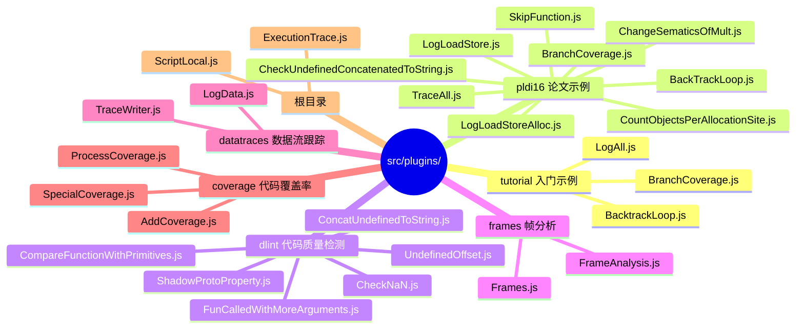

# 示例分析插件

`src/plugins/` 目录下提供了多个示例分析插件，涵盖不同的动态分析场景，
既可直接使用，也是编写自定义分析的参考范本。

## 插件分类概览



## 插件目录

```
src/plugins/
  ExecutionTrace.js      ← 语句级执行跟踪分析（逆向分析专用，见下文详细设计）
  ScriptLocal.js         ← 脚本局部变量分析工具
  tutorial/              ← 入门教程级别的示例
    LogAll.js            ← 记录所有运行时事件
    BranchCoverage.js    ← 分支覆盖率统计
    BacktrackLoop.js     ← 回溯循环（MultiSE 示例）
  pldi16/                ← PLDI 2016 论文对应示例
    TraceAll.js          ← 完整执行跟踪（需 SMemory）
    LogLoadStore.js      ← 内存读写跟踪（需 SMemory）
    LogLoadStoreAlloc.js ← 分配点感知的内存读写跟踪（需 SMemory）
    BranchCoverage.js    ← 分支覆盖（PLDI 版本）
    SkipFunction.js      ← 跳过函数执行示例
    ChangeSematicsOfMult.js    ← 修改乘法语义示例
    CheckUndefinedConcatenatedToString.js ← undefined 字符串拼接检测（PLDI 版本）
    BackTrackLoop.js           ← 回溯循环（PLDI 版本）
    CountObjectsPerAllocationSite.js ← 按分配点统计对象数
  dlint/                 ← 代码质量检测（DLint）
    CheckNaN.js          ← NaN 比较检测
    UndefinedOffset.js   ← undefined 属性访问检测
    ConcatUndefinedToString.js ← undefined 字符串拼接检测
    FunCalledWithMoreArguments.js ← 参数过多检测
    ShadowProtoProperty.js     ← 原型属性遮蔽检测
    CompareFunctionWithPrimitives.js ← 函数与原始值比较检测
  frames/                ← 帧分析
    FrameAnalysis.js
    Frames.js
  datatraces/            ← 数据流跟踪（需 Trace Server）
    LogData.js
    TraceWriter.js
  coverage/              ← 代码覆盖率
    AddCoverage.js
    ProcessCoverage.js
    SpecialCoverage.js
```

---

## tutorial/ — 入门示例

### LogAll — 记录所有事件

**文件**：`src/plugins/tutorial/LogAll.js`

记录程序执行过程中所有运行时事件（函数调用、属性读写、变量读写等）。
适合作为"Hello World"级别的起点。

```js
import { JalangiSandbox }           from './src/runtime/JalangiSandbox.js';
import { SMemory, SMemoryPlugin }   from './src/runtime/SMemory.js';
import { LogAllAnalysis }           from './src/plugins/tutorial/LogAll.js';

const J$ = globalThis.J$ = new JalangiSandbox();
const smemory = new SMemory(J$);
J$.smemory = smemory;
J$.analysis.use(new SMemoryPlugin(smemory))
           .use(new LogAllAnalysis(smemory, J$));
```

**示例输出**：
```
getField({"base":1,"offset":"log","isMethodCall":true}) at example.js:(1:9)-(1:20)
putField({"base":2,"offset":"x","val":42}) at example.js:(2:1)-(2:10)
```

---

### BranchCoverage — 分支覆盖率

**文件**：`src/plugins/tutorial/BranchCoverage.js`

统计每个条件表达式（`if`、`while`、`?:`、`&&`、`||`）中 true/false 分支被执行的次数。

```js
import { BranchCoverageAnalysis } from './src/plugins/tutorial/BranchCoverage.js';

J$.analysis.use(new BranchCoverageAnalysis(J$));
```

**实现原理**：实现 `conditional(iid, result)` 钩子，
用 `J$.getGlobalIID(iid)` 作为 key 统计 true/false 分支次数，
在 `endExecution()` 中打印结果。

**示例输出**：
```
True branch taken at example.js:(5:5)-(5:15) 3 times
False branch taken at example.js:(5:5)-(5:15) 1 times
```

---

## pldi16/ — PLDI 2016 示例

### TraceAll — 完整执行跟踪

**文件**：`src/plugins/pldi16/TraceAll.js`

打印程序执行过程中所有运行时事件，包括函数调用层级（缩进显示）和对象 ID。
需要配合 SMemory 使用。

```js
import { SMemory, SMemoryPlugin } from './src/runtime/SMemory.js';
import { TraceAllAnalysis }        from './src/plugins/pldi16/TraceAll.js';

const smemory = new SMemory(J$);
J$.smemory = smemory;
J$.analysis.use(new SMemoryPlugin(smemory))
           .use(new TraceAllAnalysis(J$));
```

---

### LogLoadStore — 内存读写跟踪

**文件**：`src/plugins/pldi16/LogLoadStore.js`

跟踪所有对象属性和变量的读写操作，记录操作发生时的对象 ID 和位置。

---

### LogLoadStoreAlloc — 分配点感知跟踪

**文件**：`src/plugins/pldi16/LogLoadStoreAlloc.js`

在 `LogLoadStore` 基础上，追加对象分配点（allocation site）信息。
可回答"这个对象是在哪里创建的"这一问题。

---

### CheckUndefinedConcatenatedToString — undefined 字符串拼接检测（PLDI 版本）

**文件**：`src/plugins/pldi16/CheckUndefinedConcatenatedToString.js`

检测 `undefined` 被意外拼接到字符串的情况（如 `"value: " + undefined`，结果为 `"value: undefined"`）。
是 `dlint/ConcatUndefinedToString.js` 的 PLDI 论文版本，使用 `getGlobalIID` + `iidToLocation` 输出报告。

**检测目标**：二元 `+` 运算，结果为字符串，且左操作数或右操作数为 `undefined`。

---

## dlint/ — DLint 代码质量检测

DLint 是一套运行时 JavaScript 代码质量检查工具，检测常见编程错误。

### CheckNaN — NaN 比较检测

**文件**：`src/plugins/dlint/CheckNaN.js`

检测 NaN 参与比较运算的情况（`NaN == x` 等，这类比较始终为 false）。

```js
import { CheckNaN } from './src/plugins/dlint/CheckNaN.js';
J$.analysis.use(new CheckNaN(J$));
```

**检测目标**：比较运算符（`==`, `===`, `!=`, `!==`, `<`, `>`, `<=`, `>=`）中有操作数为 NaN。

---

### UndefinedOffset — undefined 属性访问检测

**文件**：`src/plugins/dlint/UndefinedOffset.js`

检测对 `undefined` 或 `null` 对象进行属性访问的情况。

---

### ConcatUndefinedToString — undefined 字符串拼接检测

**文件**：`src/plugins/dlint/ConcatUndefinedToString.js`

检测 `undefined` 被意外拼接到字符串的情况（如 `"value: " + undefined`）。

---

### FunCalledWithMoreArguments — 参数过多检测

**文件**：`src/plugins/dlint/FunCalledWithMoreArguments.js`

检测函数调用时传入参数多于函数声明参数数量的情况。

---

### ShadowProtoProperty — 原型属性遮蔽检测

**文件**：`src/plugins/dlint/ShadowProtoProperty.js`

检测对象实例属性遮蔽（shadow）了原型链上同名属性的情况。

---

### CompareFunctionWithPrimitives — 函数与原始值比较

**文件**：`src/plugins/dlint/CompareFunctionWithPrimitives.js`

检测将函数对象与原始值进行相等比较的情况（通常是忘记调用函数的 bug）。

---

## coverage/ — 代码覆盖率

### AddCoverage — 覆盖率数据收集

**文件**：`src/plugins/coverage/AddCoverage.js`

高级覆盖率分析框架，支持多维度特征追踪和测试用例最小化（delta debugging）。
将覆盖率数据持久化到 `features.json`，结果写入 `results.json`。

---

## ExecutionTrace — 语句级执行跟踪

**文件**：`src/plugins/ExecutionTrace.js`

专为逆向分析设计的执行跟踪插件，提供**语句级**和**函数级**追踪。

### 设计目标

| 目标 | 说明 |
|------|------|
| **用途** | 为逆向分析提供 trace 数据 |
| **粒度** | 语句级 + 函数级，不做更细粒度追踪 |
| **只读** | 不修改任何数据，只观测 |
| **高效** | 避免不必要的操作 |
| **精炼** | 每行一条语句，相邻语句输出在相邻行 |

### 追踪内容

**语句级**：
- 每个表达式语句输出一行
- 包含源码文本 + 所有涉及变量和属性的值
- 变量值来源：`writeVar` hook（写入值）+ Shadow Frame 查询（读取值，方案 F）
- 属性值来源：`getField` / `putField` hook（方案 C）
- 同一变量既读又写时，只保留写入值（执行后的值）
- 多变量声明（`var a=1, b=2`）合并为一行输出

**函数级**：
- CALL：函数调用时输出，包含函数名、参数
- RETN：函数返回时输出，包含返回值
- CALL/RETN 独立成行，不与语句合并

**不追踪**：
- 二元运算、一元运算
- 字面量
- 条件表达式

**属性读写**（见下文「方案 C — 静态属性访问聚合」）：
- 已实现：通过 `getField` / `putField` hook 暂存属性读写，运行时在 `endExpression` 统一输出，与变量读写合并成一行

### 过滤规则

以下全局内置对象不追踪（常量引用，对逆向分析无意义）：
```
String, Number, Boolean, Object, Array, Function, Symbol, BigInt,
Math, Date, RegExp, Error, JSON, Promise, Map, Set, WeakMap, WeakSet,
Proxy, Reflect, console, window, global, globalThis, document, navigator,
undefined, NaN, Infinity
```

### 输出格式

默认使用 `FORMAT_FLAT`（平铺流式），每个事件立即输出，不等函数返回。

所有行统一遵循 `[seq] [line:col] 描述 ; kv` 格式：

```text
[  1] [     1:1] var o = "", i = 0, c = 0; ; o="", i=0, c=0
[  2] [     3:1] o += String.fromCharCode(c ^ 52); ; o="U", c=65
[  3] [     3:5] CALL .fromCharCode(1 args) ; this=[Function String], arg0=65
[  4] [     3:5] RETN fromCharCode ; ="U"
[  5] [     5:1] return o; ; (return)="U"
```

格式说明：
- `[seq]` — 序号（递增）
- `[line:col]` — 源码位置
- 描述 — 语句文本 / CALL 函数调用 / RETN 函数返回
- `; kv` — 变量值列表，格式 `name=value`（返回值为 `=value`）

### 用法

```js
import { JalangiSandbox } from './src/runtime/JalangiSandbox.js';
import { ExecutionTraceAnalysis } from './src/plugins/ExecutionTrace.js';

const J$ = globalThis.J$ = new JalangiSandbox();
J$.analysis = new ExecutionTraceAnalysis(J$, originalSourceCode, {
    useIdb: true,  // 使用 IndexedDB 持久化
});
```

自动配置推导（无需手写 Config）：

```js
import { init } from './src/instrument/esnstrument.js';
const analysis = new ExecutionTraceAnalysis(J$, src, opts);
init(null, undefined, undefined, undefined, [analysis]);
// 插桩器会自动推导需要的 hooks（writeVar, readVar, endExpression 等）
```

### 与 TraceAll 的区别

| 特性 | ExecutionTrace | TraceAll |
|------|---------------|----------|
| 粒度 | 语句级 | 指令级 |
| 输出量 | 小（每语句一行）| 大（每操作一行）|
| 用途 | 逆向分析 | 调试/研究 |
| 依赖 | 无 SMemory | 需要 SMemory |
| Call 深度 | 无缩进 | 树形缩进 |

### 变量读取实现：方案 F — Xe 携带静态 use-set（✅ 已实现）

**核心思路**：在插桩阶段，将"本语句读取的变量列表"编码到 `J$.Xe` 的参数里，运行时 `endExpression` 直接查 Shadow Frame 取值，完全消除 `readVar` hook 和 `INSTR_READ` 插桩需求。

**插桩后形态**：

```js
// o += String.fromCharCode(c ^ 52);
J$.Xe(iid, J$.W(...J$.Rl(s,'o')...J$.Rl(s,'c')...),
      ['o', 'c'],      // ← 静态 use 变量名列表（插桩时已知）
      [s_o, s_c],      // ← 对应 defScopeId 列表（插桩时已知）
      [val_o, val_c])  // ← 变量当前值列表（运行时从 Shadow Frame 查询）
```

**运行时处理**：

```js
// JalangiRuntime.js Xe()
Xe(iid, val, useNames, useScopes, useValues) {
    // useValues 由运行时从 Shadow Frame 查询填充
    for (let i = 0; i < useNames.length; i++) {
        useValues[i] = shadowLookup(useScopes[i], resolveCallId(useScopes[i]), useNames[i]);
    }
    analysis.endExpression(iid, val, useNames, useScopes, useValues);
}
```

**改动范围**：

| 模块 | 改动内容 |
|------|---------|
| `dataflow.js` | 导出 `analyzeStmtUse()` 函数，提供语句级 use-set |
| `wrappers.js` | `wrapWithX1()` 增加 `useNames`/`useScopes` 参数 |
| `esnstrument.js` | `ExpressionStatement.exit` 收集 use-set 并传给 `wrapWithX1` |
| `JalangiRuntime.js` | `Xe()` 接收 use-set 参数，查询 Shadow Frame 填充 useValues |
| `ExecutionTrace.js` | `endExpression` 从参数获取 useValues；删除 `readVar` 钩子 |
| `analysisCallbackTemplate.js` | `endExpression` 签名更新为 `(iid, val, useNames, useScopes, useValues)` |

**效果**：

| 对比项 | 方案 F（已实现）|
|--------|--------|
| `INSTR_READ` 开启 | ❌ 否（零代码膨胀）|
| 变量读取调用链 | 零（Shadow Frame 直接查询）|
| Shadow Frame miss | 全局变量/eval 变量（少量场景可降级处理）|

---

### 属性读写追踪：方案 C — 静态属性访问聚合（✅ 已实现）

**背景**：`getField`（`J$.G`）和 `putField`（`J$.P`）是两个最高频的插桩点，几乎每条语句都涉及属性访问（如 `obj.key`、`arr[i]`）。若无差别开启全量属性插桩，代码膨胀程度最为严重。

##### 三种方案对比

| 方案 | 做法 | 代码膨胀 | 属性可见性 |
|------|------|----------|----------|
| **方案 A（全量）** | 开启 `getField` / `putField` 钩子 | ⚠️ 显著（每次属性访问都插桩）| ✅ 完整 |
| **方案 B（不追踪）** | 不开启任何属性钩子 | ✅ 无 | ❌ 不可见 |
| **方案 C（静态聚合）** | 插桩阶段静态分析语句内属性访问，运行时在 `endExpression` 聚合输出 | ✅ 最小 | ✅ 语句级可见 |

##### 方案 C 设计

**核心思路**：`endExpression` 已携带当前语句的静态 use-set（见方案 F）。在方案 F 的基础上扩展：
- 静态分析阶段同时收集语句内所有 **属性读取**（`MemberExpression` base + offset）和 **属性写入**（`AssignmentExpression` 左侧 `MemberExpression`）
- 运行时 `getField` / `putField` hook **不直接输出**，而是暂存到当前语句的缓冲区
- `endExpression` 统一合并变量读写 + 属性读写 → 输出一行

**插桩后形态**：

```js
// o.x = arr[i] + 1;
// 方案 C（在方案 F 基础上）：
J$.Xe(iid,
  J$.P(iid, o, 'x', J$.B(..., J$.G(iid, arr, i), 1)),
  ['o'],            // ← 静态 use 变量名
  [s_o],            // ← 对应 defScopeId
  ['o.x', 'arr[i]'] // ← 静态属性访问路径（可选，辅助展示）
)
```

**运行时处理**：

```js
// ExecutionTrace.js
getField(iid, base, offset, val) {
    // 暂存到当前语句缓冲区，不立即输出
    this._pendingFields.push(`${serialize(base)}.${String(offset)}=${serialize(val)}`);
    return { result: val };
}

putField(iid, base, offset, val) {
    // 写入时同样暂存
    this._pendingFields.push(`${serialize(base)}.${String(offset)}=${serialize(val)}`);
    return { result: val };
}

endExpression(iid, result, useNames, useScopes) {
    // 合并：变量 kv + 属性 kv
    const allKvs = [...this._pendingKvs, ...this._pendingFields];
    this._pendingFields = [];
    // ... 输出一行 ...
}
```

**Config 影响**：

```js
// pluginAnalyzer 推导 Config：
{
    INSTR_READ:     () => false,  // 方案 F 消除，不开启
    INSTR_GETFIELD: null,         // 方案 C：开启属性读取插桩
    INSTR_PUTFIELD: null,         // 方案 C：开启属性写入插桩
    INSTR_WRITE:    null,         // 变量写入，保留
    // ... 其余 null
}
```

> **注意**：`INSTR_GETFIELD` 和 `INSTR_PUTFIELD` 的开启会带来一定膨胀，但相比全量 `INSTR_READ` 更可控——因为属性访问的 hook 调用开销和变量读取类似，而暂存+聚合策略保证每条语句只新增一次 `endExpression` 的合并操作，不额外增加输出行数。

**方案 C 输出示例（目标格式）**：

```text
[  1] [   3:1] o += String.fromCharCode(c ^ 52) ; o="U", c=65
[  2] [   5:1] x = obj.key + arr[0] ; x=42, obj.key=10, arr[0]=32, arr={0:32}
[  3] [   7:1] result.val = compute(n) ; result.val="done", n=3
```

**改动范围（方案 C 在方案 F 基础上的额外改动）**：

| 模块 | 改动内容 |
|------|----------|
| `dataflow.js` | 分析时额外收集语句内 `MemberExpression` 节点的 base/offset 静态信息 |
| `wrappers.js` | `wrapWithX1` 增加 `propPaths` 参数（可选，属性访问路径列表） |
| `ExecutionTrace.js` | 添加 `getField` / `putField` hook，缓冲到 `_pendingFields`；`endExpression` 合并输出 |

> **注**：方案 C 依赖方案 F（`Xe` 携带 use-set）作为基础，两者配合才能做到「变量 + 属性」统一在 `endExpression` 输出，实现零冗余行、最小代码膨胀的语句级完整 trace。方案 C 尚未实现。

---

## datatraces/ — 数据流跟踪

### LogData / TraceWriter

配合 `npm run trace-server` 启动的 WebSocket 服务器，
将运行时事件实时推送到浏览器端或持久化到文件。
每个 WebSocket 连接（即每次页面加载/刷新）对应 `traces/` 目录下一个独立的 `.ndjson` 文件，
不同会话的数据不会混写。

```bash
# 1. 启动 Trace Server（输出到 traces/ 目录，每次连接生成独立文件）
npm run trace-server

# 自定义输出目录
node tools/trace-server/server.mjs --out my-traces

# 2. 在分析中使用 WsBackend
# （通过 JalangiSandbox 配置，详见 Runtime-System.md）
```

> 详细参数说明参见 [Runtime-System.md — Trace Server](./Runtime-System.md#trace-servertools-trace-serverservermjs)。

---

## 选择合适的示例

| 场景 | 推荐插件 |
|------|---------|
| 学习 Jani 基础 | `tutorial/LogAll.js` |
| 统计分支覆盖率 | `tutorial/BranchCoverage.js` |
| 完整执行跟踪（指令级）| `pldi16/TraceAll.js` |
| 逆向分析（语句级）| `ExecutionTrace.js` |
| 追踪内存读写 | `pldi16/LogLoadStore.js` |
| NaN 错误检测 | `dlint/CheckNaN.js` |
| 多种代码质量检测 | `dlint/*.js`（链式注册多个）|
| 覆盖率驱动测试 | `coverage/AddCoverage.js` |
| 实时浏览器数据流 | `datatraces/TraceWriter.js` + trace-server |

## 注册多个 DLint 分析

```js
import { CheckNaN }               from './src/plugins/dlint/CheckNaN.js';
import { UndefinedOffset }         from './src/plugins/dlint/UndefinedOffset.js';
import { ConcatUndefinedToString } from './src/plugins/dlint/ConcatUndefinedToString.js';

J$.analysis
    .use(new CheckNaN(J$))
    .use(new UndefinedOffset(J$))
    .use(new ConcatUndefinedToString(J$));
```
