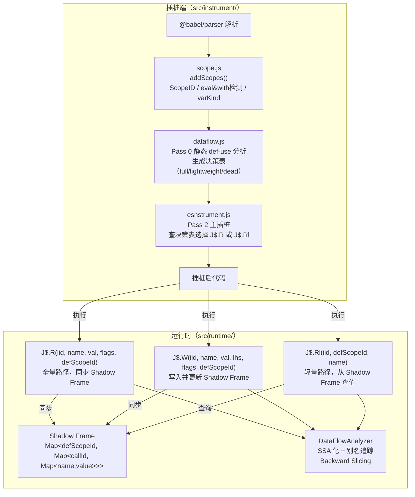
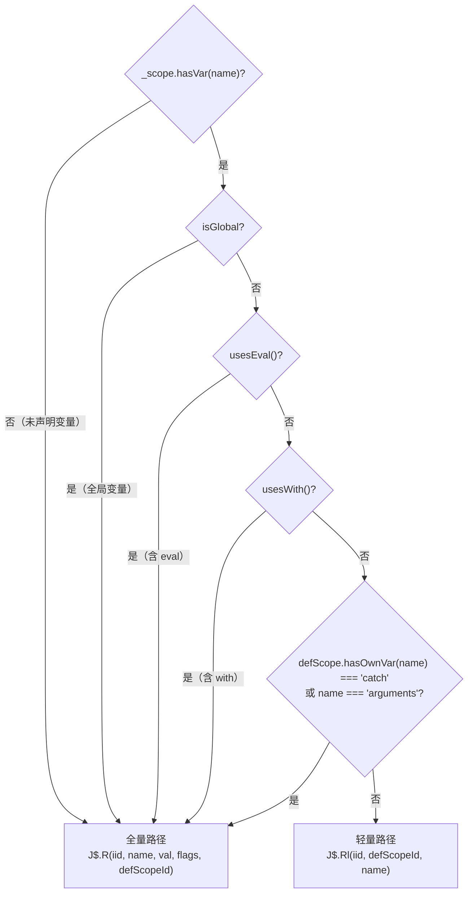
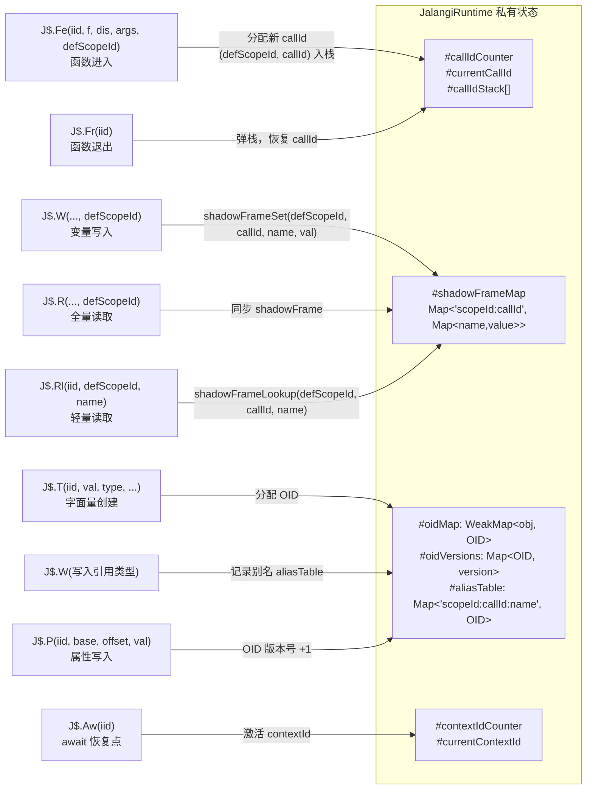

# 作用域感知插桩——技术设计文档

> **目标**：构建一套工业级 JS 动态逆向分析工具，核心能力包括：
> 1. **作用域感知的精简插桩**——用"左值状态机"替代无差别右值 log，消除代码体积膨胀
> 2. **SSA 化的运行时数据流分析**——对 trace log 做 backward slicing，还原被 VMP/混淆保护的算法逻辑
> 3. **对象别名追踪**——用 OID（对象唯一 ID）+ 版本号处理 `a=b={}` 类的引用变异
> 4. **异步执行上下文追踪**——用 ContextID/CallID 解决异步 log 交叉感染问题
> 5. **反插桩对抗**——隐藏插桩指纹，绕过恶意代码的自校验检测

---

## 整体架构概览



---

## 第一部分：背景与问题诊断

### 1.1 核心痛点：无差别右值 log

原始插桩策略对每个 `Identifier` 在 RHS 上下文都注入 `J$.R`，对每个属性读取注入 `J$.G`，导致：

- **代码体积膨胀约 10 倍**：原本 `x + y` 变成 `J$.B(iid, '+', J$.R(iid, 'x', x, flags), J$.R(iid, 'y', y, flags))`
- **JIT 优化被破坏**：V8 无法对多层包裹的表达式做 Inline 优化，性能显著下降
- **log 充斥冗余信息**：同一变量在两次写入之间的所有读取，值完全相同，记录意义接近于零

```js
// 原始代码
let x = 1;
let y = x + x;  // x 被读了两次，值都是 1

// 插桩后（每次读取都触发回调）
let x = J$.W(8,  'x', J$.T(1, 1, 22, false), x, 0b001);
let y = J$.W(40, 'y',
    J$.B(32, '+',
        J$.R(16, 'x', x, 0b00),  // ← 第一次读 x（值 = 1）
        J$.R(24, 'x', x, 0b00)   // ← 第二次读 x（值还是 1，完全冗余）
    ),
    y, 0b001
);
```

### 1.2 核心设计洞察

**放弃无差别 R-Value 记录**：如果已经记录了所有左值（L-Value）的变更，调试时可以通过回溯上一次赋值来推断当前右值。追踪重点应集中在：
- 赋值语句（`AssignmentExpression`）
- 函数调用返回值（`CallExpression`）
- 非确定性 API（`Math.random`、`Date.now`）

**数据流优先**：控制流是虚幻的，只有数据流才是真实的。即使算法被切成了 1000 个 case，只要追踪了赋值，在数据流图里就能一眼看清主干。

**SSA 化 log**：为每一次赋值创建一个唯一的寄存器 ID，维护 LastWrite 表，构建动态数据流图（DDG）。有了作用域追踪，可以给同名变量打上唯一 ID（如 `a_scope1`、`a_scope2`），使混淆代码中的同名变量可区分。

---

## 第二部分：插桩端改造（`src/instrument/`）

### 2.1 Scope 安全标志：eval 与 with 检测

`eval` 和 `with` 语句都能打败静态分析：`eval` 可在运行时动态引入变量，`with(obj) { x }` 中的 `x` 可能引用 `obj.x` 而非局部变量。凡含这两者的作用域，必须退回全量插桩路径。

**eval 检测**（`scope.js` — `addScopes` 的 `visitorPost.Identifier`）：

```js
Identifier(node, context) {
    // 已有：arguments 重命名
    if (context === CONTEXT.RHS && node.name === FROM_NAME && currentScope?.hasOwnVar(TO_NAME)) {
        node.name = TO_NAME;
    }
    // 检测 eval：只要 eval 作为标识符出现（包括 foo(eval) 传递），就标记整条作用域链
    if (node.name === 'eval') {
        currentScope?.addEval();
    }
    return node;
},
```

**with 检测**（`Scope` 类新增 `hasWith_` 标志）：

```js
class Scope {
    constructor(parent, isCatch) {
        // ... 已有字段 ...
        this.hasWith_ = false;  // 新增
    }

    addWith() {
        for (let s = this; s !== null; s = s.parent) s.hasWith_ = true;
    }
    usesWith() { return this.hasWith_; }
}
```

在 `esnstrument.js` 的 `visitorOps.WithStatement` 和 `addScopes` 的 `visitorPost.WithStatement` 两处均需调用 `addWith()`：

```js
// esnstrument.js visitorOps
WithStatement(node) {
    W.getScope()?.addWith();   // 标记
    node.object = W.wrapWith(node.object);
    return node;
},
```

### 2.2 Scope 唯一 ID

混淆代码大量复用变量名（整个程序只有 `a, b, c`）。没有 ScopeID，运行时 `J$.W(iid, 'a', ...)` 中的 `'a'` 是哪个作用域的 `a` 完全无从区分，数据流分析不可靠。

`scope.js` 顶部维护一个文件级计数器，每个 `Scope` 构造时自增：

```js
let _scopeIdCounter = 0;

export function resetScopeCounter() {
    _scopeIdCounter = 0;
}

class Scope {
    constructor(parent, isCatch) {
        this.id = _scopeIdCounter++;  // 唯一词法作用域 ID
        // ...
    }
}
```

`resetScopeCounter()` 必须在每次 `instrumentCode()` 开头调用（与 `IID.initialize()` 和 `W.resetPerFile()` 并列），保证插桩幂等性。**注意**：不应在 `iid.js` 的 `initialize()` 内调用，否则会引入 `iid.js → scope.js` 的循环依赖风险。

```js
// esnstrument.js instrumentCode() 的初始化序列
IID.initialize(isEval, options.instCodeFileName, options.origCodeFileName);
W.resetPerFile();
resetScopeCounter();
```

### 2.3 变量声明 kind 记录（const/let/var）

`const` 变量不可重赋值，是最强的静态优化依据——`const` 基础类型变量的所有读取都可以省略 `J$.R`。`Scope.addVar` 增加 `kind` 参数，并新增 `getVarKind()` 查询接口：

```js
addVar(name, type, loc, node, kind) {
    const target = (this.isCatch && type !== 'catch') ? this.parent : this;
    if (target.vars[name] !== 'arg') {
        target.vars[name] = type;
    }
    if (kind) {
        target.varKinds = target.varKinds ?? {};
        target.varKinds[name] = kind;
    }
    // ...
}

getVarKind(name) {
    for (let s = this; s !== null; s = s.parent) {
        if (s.varKinds?.[name]) return s.varKinds[name];
    }
    return null;
}
```

`addScopes` 内用 `_currentDeclKind` 暂存当前 `VariableDeclaration.kind`，在 `VariableDeclarator` 的 handler 里传给 `addVar`。

### 2.4 闭包变量定义域追踪

闭包读取时，读取点和定义点不在同一个作用域：

```js
function outer() {
    let x = 1;              // 定义点：outer 的 Scope（scopeId=0）
    function inner() {
        console.log(x);     // 读取点：inner 的 Scope（scopeId=1），但 x 属于 scopeId=0
    }
}
```

如果 `J$.Rl(iid, scopeId_inner, 'x')` 用的是 inner 的 scopeId，运行时 Shadow Frame 里找不到 `x`（值存在 outer 的 frame 里）。

解决方案：在 `instrumentLoad` 中，沿作用域链向上查找**第一个 `hasOwnVar(name)` 为真**的 Scope，用那个 Scope 的 id：

```js
function _findDefScope(scope, name) {
    for (let s = scope; s !== null; s = s.parent) {
        if (s.hasOwnVar(name)) return s;
    }
    return null;
}
```

### 2.5 向钩子传入 scopeId

`J$.R`、`J$.W`、`J$.Fe`、`J$.N` 均增加尾部可选参数 `scopeId`，所有变化**向后兼容**——现有分析插件不修改签名即可继续工作。

| 钩子 | 改造后签名 |
|------|-----------|
| `J$.R`  | `(iid, name, val, flags, scopeId?)` |
| `J$.W`  | `(iid, name, val, lhs, flags, scopeId?)` |
| `J$.Fe` | `(iid, f, dis, args, scopeId?)` |
| `J$.Fr` | `(iid)` → 返回 `isBacktrack`（不变） |
| `J$.N`  | `(iid, name, val, flags, scopeId?)` |
| `J$.Rl` | `(iid, defScopeId, name)`（**新增**） |
| `J$.Aw` | `(iid, val, ctxId)`（**新增**） |

`scopeId` 来自 `_findDefScope()` 的结果：写入时取 def scope 的 id；函数入口处取 `_scope.id`。

### 2.6 轻量读取路径（`J$.Rl`）

**设计原则**：对"静态可信的局部变量读取"，不传 `value`，只传 `(iid, defScopeId, name)`。运行时从 Shadow Frame 查值，省去代码求值传入的开销。

满足以下**所有条件**才走轻量路径，否则退回 `J$.R` 全量：

| 条件 | 检查方式 |
|------|---------|
| 变量在词法上已声明 | `_scope.hasVar(name)` |
| 不是全局变量 | `!_scope.isGlobal(name)` |
| 作用域内无 `eval` | `!_scope.usesEval()` |
| 作用域内无 `with` | `!_scope.usesWith()` |
| 不是 `catch` 参数 | `defScope.hasOwnVar(name) !== 'catch'` |
| 不是 `arguments` | `name !== 'arguments'` |
| 引用类型变量 | 走 `J$.Rl` 但不做 dead read 消除（Proxy 安全） |



```js
function wrapReadLightweight(node, name, defScopeId, varKind) {
    if (!Config.INSTR_READ || Config.INSTR_READ(name, node)) {
        IID.printIidToLoc(node);
        const ret = replaceInExpr(
            `${logReadLightFunName}(${RP}1, ${defScopeId}, ${RP}2)`,
            IID.getIid(), name
        );
        transferLoc(ret, node);
        return ret;
    }
    return node;
}
```

`instrumentLoad` 中的决策逻辑（优先查静态决策表，再退化为 fallback）：

```js
function instrumentLoad(ast, isTypeof) {
    if (ast.type === 'Identifier') {
        if (_scope.hasVar(ast.name)) {
            const defScope = _findDefScope(_scope, ast.name);
            const isGlobal = _scope.isGlobal(ast.name);

            // 1. 查静态决策表（dataflow.js 产出）
            let decision = null;
            if (_instrDecisions !== null && ast.loc) {
                const loc = ast.loc.start;
                const key = `${_scope.id}:${ast.name}:${loc.line}:${loc.column}`;
                decision = _instrDecisions.get(key) ?? null;
            }

            // 安全兜底条件（catch 参数和 arguments 强制全量）
            const isSafeForLightweight =
                defScope !== null && !isGlobal &&
                defScope.hasOwnVar(ast.name) !== 'catch' &&
                ast.name !== 'arguments';

            if (decision === 'lightweight' && isSafeForLightweight) {
                return wrapReadLightweight(ast, createLiteralAst(ast.name), defScope.id);
            }

            // 2. Fallback 保守判断（决策表无记录，如闭包变量）
            if (decision === null) {
                const canUseLightweight =
                    defScope !== null && !isGlobal &&
                    !_scope.usesEval() && !_scope.usesWith() &&
                    defScope.hasOwnVar(ast.name) !== 'catch' &&
                    ast.name !== 'arguments';
                if (canUseLightweight) {
                    return wrapReadLightweight(ast, createLiteralAst(ast.name), defScope.id);
                }
            }

            // 3. 全量路径
            return wrapRead(ast, createLiteralAst(ast.name), ast, false, false, isGlobal, defScope?.id);
        }
    }
}
```

### 2.7 第三个 AST Pass：def-use 分析驱动的插桩决策

`transformString` 在现有两个 pass（`visitorRRPost` + `visitorOps`）之前，新增一个 **Pass 0**：对原始 AST 做 def-use 分析，生成决策表，后续 pass 查表决定每个 use-site 的插桩级别。

```js
function transformString(code, visitorsPost, visitorsPre, sourceType) {
    const newAst = babelParse(code, sourceType);
    addScopes(newAst);
    
    // Pass 0：def-use 分析，生成插桩决策表
    const instrDecisions = analyzeDefUse(newAst);  // 来自 dataflow.js
    W.setInstrDecisions(instrDecisions);
    
    for (let i = 0; i < visitorsPost.length; i++) {
        transformAst(newAst, visitorsPost[i], visitorsPre[i], CONTEXT.RHS);
    }
    return newAst;
}
```

**决策表格式**（`Map<nodeKey, 'full' | 'lightweight'>`）：

```js
// nodeKey = `${scopeId}:${name}:${line}:${col}`
// 闭包引用的变量不在表中（交 instrumentLoad fallback 处理）
const instrDecisions = new Map([
    ['1:b:5:14', 'lightweight'], // 函数内 const b，读取轻量
    ['1:a:4:12', 'lightweight'], // 函数参数 a，无重赋值，读取轻量
    ['2:z:2:8',  'full'],        // 有 eval 的作用域，全量
]);
```

### 2.8 dataflow.js：SSA def-use 分析模块

**文件**：`src/instrument/dataflow.js`  
**输入**：`addScopes` 之后的原始 AST（还未插桩）  
**输出**：`Map<nodeKey, Decision>` 决策表

**阶段 1：构建 Def-Sites 表**

遍历每个函数作用域，收集所有赋值点：

```
对每个 FunctionDeclaration / FunctionExpression / ArrowFunctionExpression：
  构建 defSites: Map<name, DefInfo>
    - defs[]: { kind: 'param'|'var'|'const'|'let'|'assign'|'update', isConditional }
    - hasReassign: 是否声明后有重赋值
    - hasMutation: 作用域内是否存在 obj.prop = ... 且 obj 就是该变量
```

**阶段 2：对每个 use-site 做决策**

> `dataflow.js` 在 `transformAst` **之前**运行（Pass 0），节点上还没有 `_isRHS` 标注。模块通过 `_isIgnoreContext()` 自行重现 `astUtil.js` 的 IGNORE 上下文判断。

```
对每个 Identifier（RHS 上下文）：
  1. 作用域含 eval 或 with → 'full'
  2. 全局变量 → 'full'
  3. 查 defSites[name]：
     a. defSites 为空（变量来自父作用域，即闭包引用）
        → 不记录到决策表，交 instrumentLoad fallback 判断
     b. hasMutation = true → 'full'（属性变动轻量路径感知不到）
     c. 只有一个 def，且 isConditional=false：
        - kind='const' → 'lightweight'
        - kind='param' 且无重赋值 → 'lightweight'
        - 其他 → 'lightweight'
     d. 多个 def（任何分支赋值）→ 'lightweight'
```

> **注**：`'dead'` 决策当前保守实现不生成（降级为 `lightweight`），保留供未来扩展。

**保守近似原则**：宁可错判成 `lightweight`，也不错判成 `dead`。以下情况一律保守：变量被传入函数、在 `try` 块内、`hasMutation=true`、作用域内有 `eval` 或 `with`。闭包引用不入表，交 fallback 判断。

---

## 第三部分：运行时改造（`src/runtime/`）

**核心数据结构关系**：



### 3.1 CallID 机制

每次 `J$.Fe`（函数进入）分配一个唯一的 `callId`。同一个函数被调用多次（递归、闭包、异步并发），每次调用的局部变量是独立的，必须用 callId 区分。

```js
// JalangiRuntime.js 私有状态
#callIdCounter = 0;
#currentCallId = 0;
#callIdStack   = [];

Fe(iid, f, dis, args, scopeId) {
    // 分配新的 callId，压栈
    const newCallId = ++this.#callIdCounter;
    this.#callIdStack.push({ callId: this.#currentCallId, scopeId });
    this.#currentCallId = newCallId;
    // ...
}

// Fr 签名：Fr(iid)，isBacktrack 是返回值
Fr(iid) {
    const frame = this.#callIdStack.pop();
    if (frame) {
        // 注意：闭包场景下不能立即清理 shadow frame，暂时保留
        this.#currentCallId = frame.callId;
    }
    // ...（原有的 isBacktrack 计算和返回）
}
```

### 3.2 Shadow Frame 机制

Shadow Frame 是一个嵌套的 Map（`defScopeId -> callId -> Map<name, value>`），在 `J$.W` 写入局部变量时同步更新，供 `J$.Rl` 查询，省去 `J$.R` 需要将值作为参数传入的开销。

```js
#shadowFrameMap = new Map(); // `${defScopeId}:${callId}` → Map<name, value>

#shadowFrameLookup(defScopeId, callId, name) {
    return this.#shadowFrameMap.get(`${defScopeId}:${callId}`)?.get(name);
}

#shadowFrameSet(defScopeId, callId, name, value) {
    const key = `${defScopeId}:${callId}`;
    let frame = this.#shadowFrameMap.get(key);
    if (!frame) { frame = new Map(); this.#shadowFrameMap.set(key, frame); }
    frame.set(name, value);
}

// J$.W 中同步写入（仅限局部变量）
W(iid, name, val, lhs, flags, scopeId) {
    const [isGlobal] = decodeBitPattern(flags, 3);
    if (!isGlobal && scopeId !== undefined) {
        this.#shadowFrameSet(scopeId, this.#currentCallId, name, val);
    }
    // ...
}
```

### 3.3 J$.Rl：轻量变量读取钩子

不接受 `value` 参数，直接从 Shadow Frame 查询当前值，并以与 `J$.R` 相同的接口分发给分析插件：

```js
Rl(iid, defScopeId, name) {
    const val = this.#shadowFrameLookup(defScopeId, this.#currentCallId, name);
    if (this.analysis?.read) {
        const ret = this.analysis.read(iid, name, val, false, false);
        return ret?.result ?? val;
    }
    return val ?? undefined;
}
```

**注意**：`J$.Rl` 的返回值直接替换了原本的 `Identifier` 节点（即 `x`），必须返回变量的当前值，否则后续的 `J$.B`、`J$.P` 等会收到 `undefined`。

### 3.4 对象 OID 机制（别名追踪）

纯变量级别的追踪无法处理别名场景：

```js
let a = {};       // J$.T 时为对象分配 OID_1
let b = a;        // b 也指向 OID_1
b.x = 1;          // J$.P 修改的是 OID_1，但变量 a 的 J$.W 没有被触发
// 此时读 a.x，如果只看变量层面，会认为 a 没有变过
```

**设计**：用 `WeakMap` 为对象分配唯一 OID，在 `J$.W` 记录别名表，在 `J$.P` 递增对象版本号：

```js
#oidCounter = 0;
#oidMap     = new WeakMap();  // 对象 → OID（不阻止 GC）

#getOrCreateOid(obj) {
    if (obj === null || typeof obj !== 'object' && typeof obj !== 'function') return null;
    if (this.#oidMap.has(obj)) return this.#oidMap.get(obj);
    const oid = ++this.#oidCounter;
    this.#oidMap.set(obj, oid);
    return oid;
}

// J$.W 中记录别名
W(iid, name, val, lhs, flags, scopeId) {
    const oid = this.#getOrCreateOid(val);
    if (oid !== null) {
        this.#aliasTable.set(`${scopeId}:${this.#currentCallId}:${name}`, oid);
    }
    // ...
}

// J$.P 中递增版本号
P(iid, base, offset, val, flags) {
    const oid = this.#getOrCreateOid(base);
    if (oid !== null) {
        this.#objectVersions.set(oid, (this.#objectVersions.get(oid) ?? 0) + 1);
    }
    // ...
}
```

**GC 注意点**：`WeakMap` 不阻止 GC，但 log 里已记录了 OID。若对象被 GC 后同一 OID 被新对象占用，分析器会混乱。解决方案：分配 OID 时同时记录对象的**创建位置（iid + scopeId）**到 log 元数据，分析器通过 `(oid, creationIid)` 二元组唯一标识对象实体。

**log 格式**：`J$.W` 条目增加 `oid` 字段；`J$.P` 条目包含 `oid` + `version`。

### 3.5 异步 ContextID 机制

JS 的异步执行（`async/await`、Promise、`setTimeout`）会导致 log 交叉感染：

```
[序号] 1  函数A：x = 1
[序号] 2  函数B（异步，插队执行）：x = 2
[序号] 3  函数A（await 恢复后）：y = x + 1  ← 此时 x 是 B 写的 2，还是 A 的 1？
```

为每个异步任务分配一个 ContextID，并在 `await` 恢复点注入标记钩子 `J$.Aw`：

```js
// JalangiRuntime.js
#asyncContextId   = 0;
#currentContextId = 0;

newAsyncContext() { return ++this.#asyncContextId; }
activateContext(contextId) { this.#currentContextId = contextId; }
```

**插桩端**（`wrappers.js`）对 `AwaitExpression` 包装，await 恢复后触发上下文切换：

```js
// wrappers.js — wrapAwait()：手工构造 AST，不走 replaceInExpr 模板
// 因为 Babel parser 在 sourceType:'script' 模式下禁止顶层 await 语法，无法解析模板字符串。
// await expr  →  J$.Aw(iid, await expr, J$__ctx)
function wrapAwait(node, argument) {
    if (!Config.INSTR_AWAIT || Config.INSTR_AWAIT(node)) {
        IID.printIidToLoc(node);
        const iidNode  = IID.getIid();
        const awaitNode  = { type: 'AwaitExpression', argument };
        const ctxVarNode = { type: 'Identifier', name: `${_jalangiVar}__ctx` };
        const ret = {
            type: 'CallExpression',
            callee: {
                type: 'MemberExpression',
                object:   { type: 'Identifier', name: _jalangiVar },
                property: { type: 'Identifier', name: 'Aw' },
                computed: false,
            },
            arguments: [iidNode, awaitNode, ctxVarNode],
        };
        transferLoc(ret, node);
        return ret;
    }
    return node;
}
```

**async 函数入口**（`wrappers.js`）为每次 async 调用捕获唯一 callId：

```js
// instrumentFunctionEntryExit() 中，对 async 函数在 J$.Fe() 之后插入：
// var J$__ctx = J$.currentCallId;
// 作用：将本次 async 调用的 callId 持久化到局部变量，
// 使 J$.Aw() 在 await 恢复时能正确识别异步上下文（#currentCallId 已被后续调用覆盖）。
function _createAsyncCtxCaptureStatement() {
    return {
        type: 'VariableDeclaration',
        kind: 'var',
        declarations: [{ type: 'VariableDeclarator',
            id:   { type: 'Identifier', name: `${_jalangiVar}__ctx` },
            init: {
                type: 'MemberExpression',
                object:   { type: 'Identifier', name: _jalangiVar },
                property: { type: 'Identifier', name: 'currentCallId' },
                computed: false,
            },
        }],
    };
}
```

需要注入 ContextID 管理的位置：

| 位置 | 插桩操作 |
|------|---------|
| `async function` 入口 | 注入 `var J$__ctx = J$.currentCallId`（捕获本次调用的 callId 作为 contextId） |
| `await expr` 处 | `await expr` → `J$.Aw(iid, await expr, J$__ctx)`；恢复时透传 resolved value，同时更新 `#currentContextId` |
| `setTimeout/setInterval` 回调 | 包装回调，入口分配新 ContextID |
| `Promise.then/catch/finally` 回调 | 同上 |
| `new Promise` 的 executor | 同上 |

**Config.INSTR_AWAIT**：控制 await 插桩的开关字段（与其他 Config 字段用法一致）：
- `null`（默认）— 全量插桩所有 `await` 表达式
- `() => false` — 完全禁用 await 插桩（保留原始 await 语义，不注入 `J$.Aw`）
- `(node) => boolean` — 细粒度控制（返回 `true` 则插桩该节点）

**log 格式**：`[全局序号][ContextID][CallID] scopeId:name = value`。后处理时按 ContextID 分组，每组是一条独立的异步执行线。

### 3.6 DataFlowAnalyzer.js：运行时 SSA + backward slicing

**文件**：`src/runtime/DataFlowAnalyzer.js`

后处理分析器，消费 Jalangi2 运行时产生的 log，在 log 上做 SSA 化 + 数据流分析，用于逆向还原算法逻辑。

**核心数据结构**：

```js
class DataFlowAnalyzer {
    #registers = new Map();  // registerID → {iid, name, value, sources: Set<registerID>}
    #lastWrite  = new Map();  // (scopeId:callId:name) → registerID（当前 active register）
    #oidVersions = new Map(); // oid → currentVersion
    #aliasTable  = new Map(); // (scopeId:callId:name) → oid

    // 处理 W 条目：为此次赋值创建新的 SSA 寄存器
    processWrite(entry) {
        const { iid, scopeId, callId, name, value, oid } = entry;
        const regId = this.#registers.size;
        const key = `${scopeId}:${callId}:${name}`;
        const sources = this.#pendingReadSources ?? new Set();
        this.#registers.set(regId, { iid, name, value, oid, sources });
        this.#lastWrite.set(key, regId);
        if (oid) this.#aliasTable.set(key, oid);
        this.#pendingReadSources = null;
        return regId;
    }

    // 处理 R/Rl 条目：返回当前 active register（即此次读取来自哪个赋值）
    processRead(entry) {
        const { scopeId, callId, name } = entry;
        return this.#lastWrite.get(`${scopeId}:${callId}:${name}`);
    }

    // 处理 P 条目：递增 OID 版本号，为所有别名变量创建新 SSA 寄存器
    processPutField(entry) {
        const { oid } = entry;
        const newVersion = (this.#oidVersions.get(oid) ?? 0) + 1;
        this.#oidVersions.set(oid, newVersion);
        for (const [key, mappedOid] of this.#aliasTable) {
            if (mappedOid === oid) {
                this.#lastWrite.set(key, this.#createOidVersionRegister(key, oid, newVersion));
            }
        }
    }

    // Backward Slicing：从终点 registerID 回溯所有影响它的赋值
    backwardSlice(targetRegId) {
        const visited = new Set();
        const result  = [];
        const queue   = [targetRegId];
        while (queue.length > 0) {
            const regId = queue.shift();
            if (visited.has(regId)) continue;
            visited.add(regId);
            const reg = this.#registers.get(regId);
            if (!reg) continue;
            result.push(reg);
            for (const srcRegId of reg.sources) queue.push(srcRegId);
        }
        return result.sort((a, b) => a.iid - b.iid);  // 按 iid 升序还原时间顺序
    }
}
```

**使用场景**：
1. **还原 VMP 算法**：找到加密结果（如 Cookie/Token），对其 backward slice，过滤掉控制流分发器变量，剩下即算法核心数据流
2. **污点分析**：标记外部输入（`fetch` 返回值、`document.cookie`）为污点源，追踪传播路径
3. **逆向切片**：从已知输出逆推输入，还原混淆算法逻辑

### 3.7 反插桩对抗（AntiDetection.js）

**文件**：`src/runtime/AntiDetection.js`

恶意脚本常用以下方式检测插桩：
1. `Function.prototype.toString()` 检测函数体是否被注入了追踪代码
2. 全局变量检测（`typeof __trace !== 'undefined'`）
3. 性能异常检测（某些操作比正常慢 10 倍以上）
4. 调用栈深度检测（`new Error().stack` 看到大量 `J$` 调用帧）

**对策 1：toString Hook**（最关键）

在脚本初始化时（`J$.Se` 前），替换 `Function.prototype.toString`，对被插桩的函数返回原始代码：

```js
export function installToStringHook(originalCodeMap) {
    const _origToString = Function.prototype.toString;
    // originalCodeMap: 函数对象 → 原始代码字符串（插桩时收集）
    Object.defineProperty(Function.prototype, 'toString', {
        value: function() {
            const orig = originalCodeMap.get(this);
            if (orig !== undefined) return orig;
            return _origToString.call(this);
        },
        writable: false,
        configurable: false,
        enumerable: false,
    });
}
```

**对策 2：全局变量隐藏**

ESM 模块化天然隔离，`J$` 不暴露为 `window.J$` 或 `globalThis.J$`，恶意脚本无法通过全局变量检测。

**对策 3：轻量化 log 减少性能开销**

轻量读取路径（`J$.Rl`）大幅减少插桩调用层数，是性能检测对抗的最佳实践。TypedArray 环形缓冲区（见 3.8 节）进一步消除 GC 压力。

**对策 4：AST 层面静态抹除检测代码**

在 `transformString` 之前增加一个 `antiDetection` pass，识别并抹除已知检测模式：

```js
const visitorAntiDetection = {
    // 模式 1：Function.toString() 长度检测
    // 识别：if (fn.toString().length > N) { ... }
    IfStatement(node) {
        if (isToStringLengthCheck(node.test)) {
            node.test = { type: 'BooleanLiteral', value: false };
        }
        return node;
    },
    // 模式 2：arguments.callee.toString() 检测
    MemberExpression(node, context) {
        if (isArgumentsCalleeToString(node)) {
            return { type: 'StringLiteral', value: 'function(){}' };
        }
        return node;
    },
};
```

### 3.8 高性能 log 缓冲——已由现有 logger 架构覆盖

> **结论**：`TypedArrayBackend.js`（`SharedArrayBuffer + Float64Array` 方案）**不再需要实现**。
> 现有 logger 系统已通过架构层面的设计解决了同等问题，且实用性更好。

原始设计动机（GC 压力、写入速度、序列化开销）已被如下已有机制覆盖：

| 原始问题 | 已有解决方案 |
|---------|------------|
| JS 对象数组 push 产生 GC 压力 | `RingBuffer.js` 预分配固定长度数组（默认 65536 槽），写入时直接赋值到槽位，drain 时清空引用，**无动态分配** |
| 主线程写入阻塞 | `LogManager.log()` 只做 `ring.push()` + 可能调度一次 `scheduleAsync()`，实际序列化/I/O 全部**异步批量**完成，主线程（即 `J$.W/R/G` 调用路径）完全不阻塞 |
| 序列化/持久化开销 | `NodeStreamBackend` 批量 NDJSON 写文件（带 OS 级写缓冲和背压控制）；`IdbWorkerBackend` 在独立 Worker 中操作 IndexedDB；`WsBackend` 支持 `format: 'binary'` 二进制传输 |

**为什么不用 `SharedArrayBuffer`**：SAB 在浏览器中需要 `COOP + COEP` 安全 header，而本项目的核心使用场景（在浏览器内分析第三方/混淆代码）几乎无法满足该 header 要求（`RingBuffer.js` 注释中已说明此约束）。

**现有 logger 模块**（`src/logger/`）：

| 文件 | 作用 |
|------|------|
| `RingBuffer.js` | 预分配环形缓冲区，主线程同步写入（极低开销） |
| `LogManager.js` | 缓冲调度器：达到阈值时异步 drain → 分发给后端 |
| `TraceLogger.js` | 按环境自动选择后端的门面（浏览器/Node.js） |
| `backends/NodeStreamBackend.js` | Node.js 文件写入（NDJSON，带背压控制） |
| `backends/IdbWorkerBackend.js` | 浏览器 IndexedDB（Worker 线程，不阻塞主线程） |
| `backends/WsBackend.js` | WebSocket 传输（支持二进制格式） |
| `backends/MemoryBackend.js` | 测试用内存后端 |

---

## 第四部分：钩子签名汇总

| 钩子 | 签名 | 说明 |
|------|------|------|
| `J$.R`  | `(iid, name, val, flags, scopeId?)` | 变量读取，增加可选 scopeId |
| `J$.W`  | `(iid, name, val, lhs, flags, scopeId?)` | 变量写入，增加可选 scopeId |
| `J$.Rl` | `(iid, defScopeId, name)` | **新增**：轻量读取，从 Shadow Frame 查值 |
| `J$.Fe` | `(iid, f, dis, args, scopeId?)` | 函数进入，增加可选 scopeId（Shadow Frame 压栈用） |
| `J$.Fr` | `(iid)` → 返回 `isBacktrack` | Shadow Frame 弹栈在运行时内部处理，签名不变 |
| `J$.N`  | `(iid, name, val, flags, scopeId?)` | 变量声明初始化，增加可选 scopeId |
| `J$.Aw` | `(iid, val, ctxId?)` | **新增**：await 恢复点，透传 resolved value，更新 `#currentContextId`，触发 `awaitResume` 回调 |

**向后兼容**：所有新增参数均为**尾部追加可选参数**，现有分析插件不修改签名即可继续工作。

---

## 第五部分：关键风险与边界条件

### 5.1 不做语法降级（Downleveling）

当前项目直接在 Babel AST 上插桩并原样输出，这是正确决策：
- 降级 `async/await → Promise.then` 会改变 `arguments.callee` 和 `Function.length`，可能触发恶意代码的反调试逻辑
- 降级 `class → function` 会让 `instanceof` 行为不一致
- 降级 `let/const → var` 会消除 TDZ（Temporal Dead Zone）。为了避免在未降级的情况下触发 TDZ `ReferenceError`，插桩器在作用域顶部同步变量（`J$.N`）时，会跳过 `let`、`const` 和 `class` 声明。

`wrapFunBodyWithTryCatch` 已明确排除 async 和 generator 函数。

### 5.2 海森堡效应：Getter 与 Proxy

对 `obj.prop` 的读取（`J$.G`）可能触发 getter，getter 内部可能修改状态——这是无法避免的副作用，插桩本身就会"观察"这些 getter。分析器需明确注意：**对属性读取的 log 并不保证纯粹性**。

### 5.3 原生 API 的非确定性

`Math.random()`、`Date.now()`、`performance.now()` 是非确定性 API，其返回值是"外部输入"，必须在 log 中记录（`J$.F`/`J$.M` 已拦截所有函数调用，包括这些 API）。如需支持确定性重放（TTD），还需在 `J$.F` 中识别这些 API 并将返回值存入 log。

### 5.4 Proxy 对象的不可见陷阱

若变量持有 Proxy，读取（get trap）本身有副作用，不能省略 `J$.R`。**保守策略**：`const` 变量若其值是对象/数组类型（通过 `J$.T` 分配了 OID），其读取走 `J$.Rl` 而非 dead read 消除，确保每次读取都经过运行时检查。

### 5.5 调用栈深度检测

恶意代码可能通过 `new Error().stack` 检查调用栈，发现大量 `J$` 相关调用帧后判定环境异常。轻量路径（`J$.Rl`）本身减少了调用层数，但 `J$.B`、`J$.G`、`J$.F` 等仍然存在。彻底解决需要 AntiDetection.js 的反插桩对抗。

---

## 第六部分：实现进度（截至 2026-03）

> 本节记录截至 2026-03 的实现现状，所有核心特性均已完整实现并通过测试。

### 6.1 已完成的工作

#### 6.1.1 插桩端（`src/instrument/`）

| 特性 | 文件 | 状态 |
|------|------|------|
| eval/with 检测与标记 | `scope.js` | ✅ |
| Scope 唯一 ID（`_scopeIdCounter`） | `scope.js` | ✅ |
| `resetScopeCounter()` 幂等重置 | `scope.js` / `esnstrument.js` | ✅ |
| 变量声明 kind 记录（const/let/var） | `scope.js` | ✅ |
| `arguments` 参数重命名（简单标识符 + 所有解构形式）| `scope.js` — `renameArgumentsInPattern()` | ✅ |
| `wrappers.js` 中 `J$.Fe` / `J$.N` 读取重命名后标识符 | `wrappers.js` | ✅ |
| `_findDefScope()` 沿链查找定义域 | `esnstrument.js` | ✅ |
| 向 `J$.R/W/Fe/N` 传入 `defScopeId` | `esnstrument.js` | ✅ |
| `J$.Rl` 轻量读取路径（插桩端生成） | `esnstrument.js` | ✅ |
| `dataflow.js` Pass 0 def-use 分析 | `dataflow.js` | ✅ |
| `pluginAnalyzer.js` 按需 Config | `pluginAnalyzer.js` | ✅ |
| `wrapAwait()` — `AwaitExpression` 插桩（`J$.Aw`）| `wrappers.js` | ✅ |

#### 6.1.2 运行时端（`src/runtime/`）

| 机制 | 文件 / 字段 | 状态 |
|------|------------|------|
| CallID 分配与压/弹栈（`selfCallId`/`selfScopeId` 双字段栈帧）| `JalangiRuntime.js` | ✅ |
| Shadow Frame 写入（`W()`、`N()`）| `JalangiRuntime.js` | ✅ |
| Shadow Frame 读取（`Rl()`，含闭包多层递推）| `JalangiRuntime.js` — `#resolveCallId()` | ✅ |
| Shadow Miss 诊断（哨兵 `_SHADOW_MISS` + `debugShadow`）| `JalangiRuntime.js` | ✅ |
| 闭包帧保护（`#closureFrameSet` + `FinalizationRegistry` GC 策略）| `JalangiRuntime.js` | ✅ |
| OID 分配与版本追踪 | `JalangiRuntime.js` | ✅ |
| 别名表 | `JalangiRuntime.js` — `#aliasTable` | ✅ |
| 异步 ContextID（`J$.Aw` 钩子实现）| `JalangiRuntime.js` | ✅ |
| `HookDispatcher` 多插件调度 + 安全错误处理 | `HookDispatcher.js` | ✅ |
| `SMemory` 向后兼容代码改用 `globalThis.J$` | `SMemory.js` | ✅ |
| `DataFlowAnalyzer.processPutField()` key 解析修复 | `DataFlowAnalyzer.js` | ✅ |

#### 6.1.3 单测覆盖（`test/instrument.test.mjs`）

- 当前共 **265 个测试用例**，**全部通过**（`npm test`）
- 覆盖：ES5～ES2022 插桩语法、`arguments` 重命名、闭包 Shadow Frame（7 个场景）、异步 ContextID、采样模式、source map、按需 Config 等

---

### 6.2 本轮 BUG 修复记录（2026-03）

| ID | 问题描述 | 修复位置 |
|----|---------|---------|
| BUG-11A | `J$.Fe` / `J$.N` 中硬编码 `arguments` 标识符，导致重命名后读取 `undefined` | `wrappers.js` — `createCallAsFunEnterStatement`、`syncDefuns` |
| BUG-2 | 解构参数中的 `arguments` 绑定未就地重命名，作用域表名称不同步 | `scope.js` — 新增 `renameArgumentsInPattern()`，在 `collectParamNames` 之前调用 |
| BUG-1 | `HookDispatcher._makeDispatcher` 中 `onError()` 调用可能掩盖原始异常（双重异常风险）| `HookDispatcher.js` — 先取出 handler 再判断类型后调用 |
| BUG-3 | `DataFlowAnalyzer.processPutField()` 的 key 解析用 `:` 拆分，含冒号的变量名被截断 | `DataFlowAnalyzer.js` — 改为 `entry.scopeId`/`entry.callId`/`entry.name` 直接读取 |
| BUG-7 | `SMemory.js` 向后兼容代码使用裸 `J$`，ESM 环境下抛出 `ReferenceError` | `SMemory.js` — 改为 `globalThis.J$` |

---

### 6.3 关键代码位置速查

| 内容 | 文件 |
|------|------|
| `Fe()` 压栈逻辑 | `src/runtime/JalangiRuntime.js` |
| `Fr()` 弹栈与 Shadow Frame 清理 | `src/runtime/JalangiRuntime.js` |
| `#resolveCallId()` 三路解析（含闭包多层递推）| `src/runtime/JalangiRuntime.js` |
| `T()` 中注册 `funcClosureCallId` / `closureFrameSet` | `src/runtime/JalangiRuntime.js` |
| `Rl()` 轻量读取 | `src/runtime/JalangiRuntime.js` |
| `N()` 形参初始化到 Shadow Frame | `src/runtime/JalangiRuntime.js` |
| `renameArgumentsInPattern()` 解构参数重命名 | `src/instrument/scope.js` |
| `createCallAsFunEnterStatement()` `arguments` 标识符选择 | `src/instrument/wrappers.js` |
| 闭包场景单测 | `test/instrument.test.mjs` |
